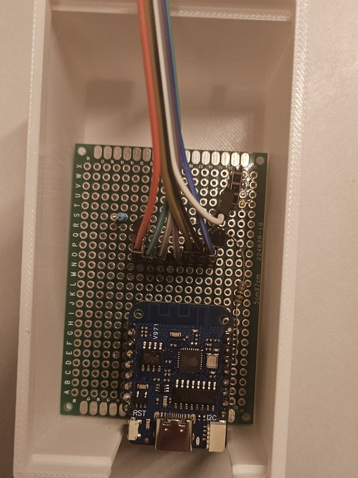
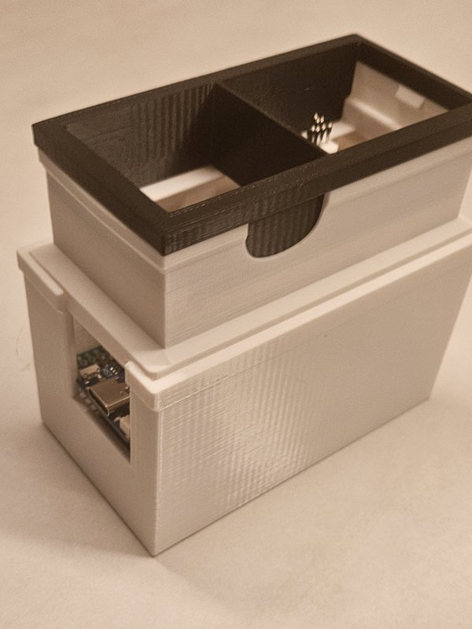
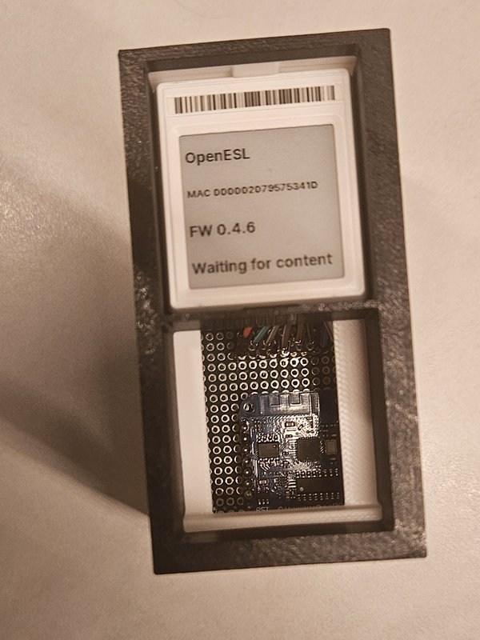
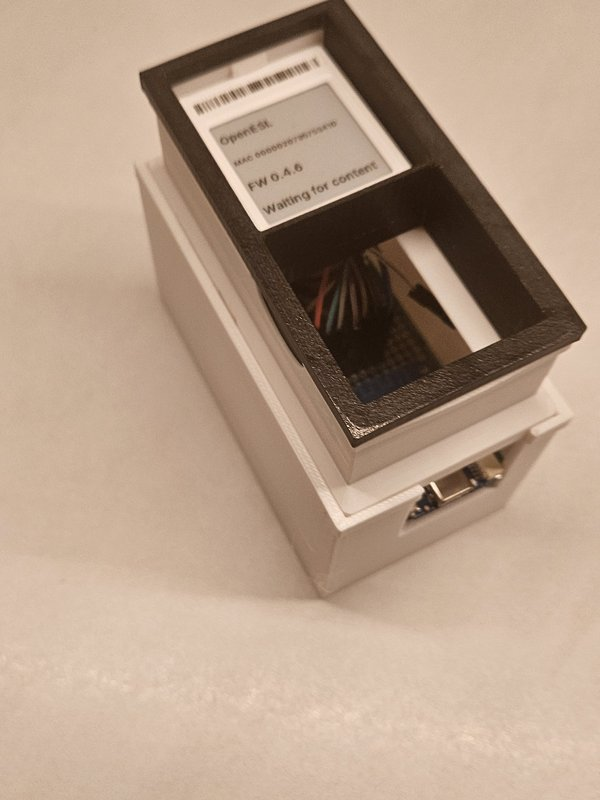
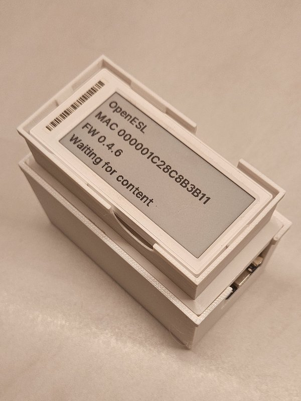
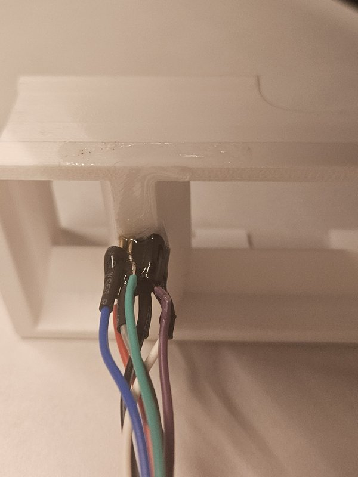
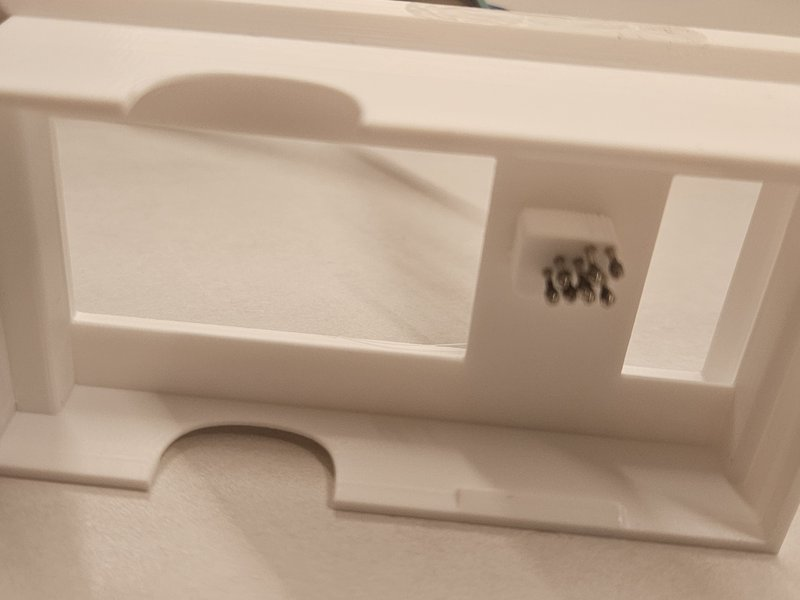
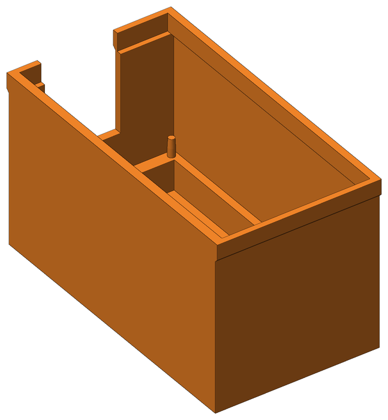
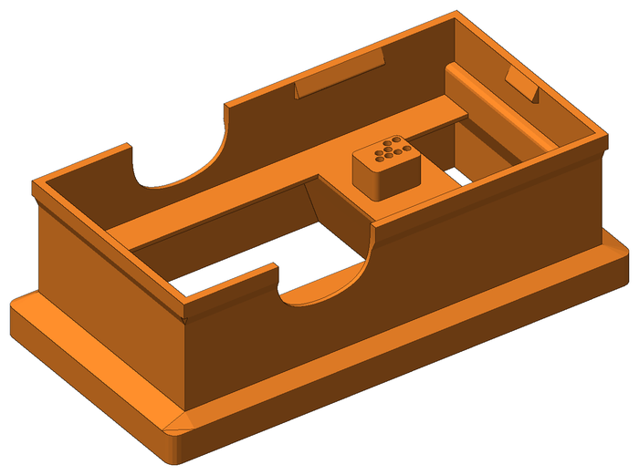
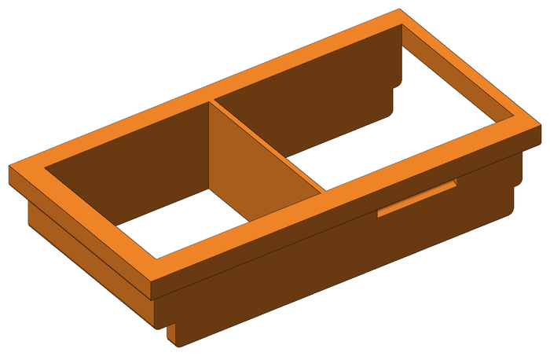

# Jig hardware

The jig holds one tag at a time with pogo pins on its debug pads. It is made for a 5x7 cm perfboard with a Wemos D1 mini on headers. The D1 mini runs atc1441's [ZBS_Flasher](https://github.com/atc1441/ZBS_Flasher), and the PC talks to it over USB with [flash-tui](../../tools/flash-tui/README.md) or the Flash tag tab on the [web page](https://mathiasbk.github.io/openESL/).

## ZBS_Flasher

Build and flash the ESP8266 version of ZBS_Flasher to the D1 mini. Its repository has the pin list for wiring the pogo pins.

## BOM

- Wemos D1 mini (ESP8266)
- 5x7 cm perfboard
- Pin headers for the D1 mini (2 x 8)
- Pogo pins, one per hole in the upper part
- Wire
- USB-C cable for the D1 mini
- The three printed parts below

## Photos

   

  

## Printed parts

The files are in [3D printet jig](3D%20printet%20jig/).

### Bottom

`jigg bottom.stl`

### Upper

`Jigg upper.obj`

### Insert

`jigg insert.obj`

