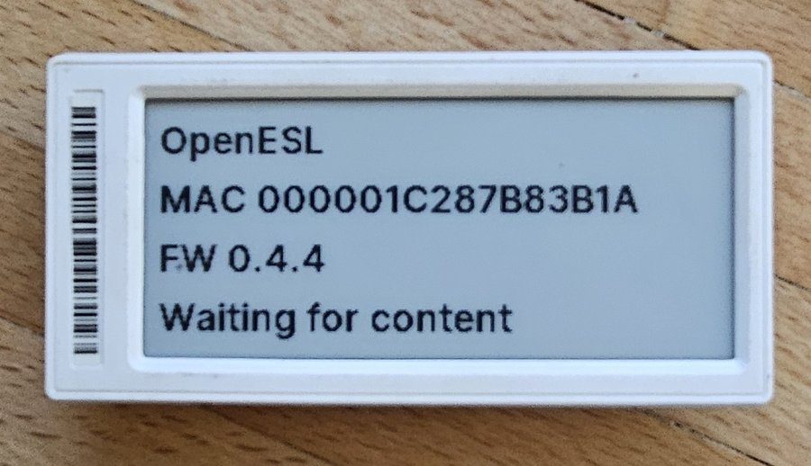
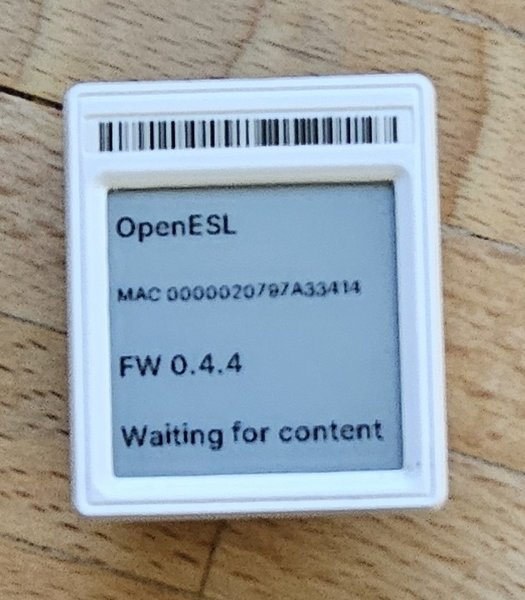
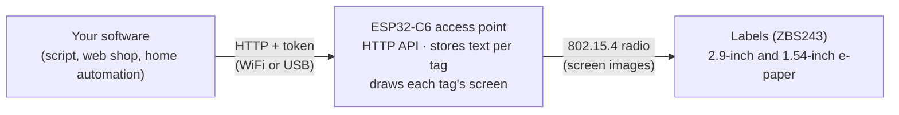
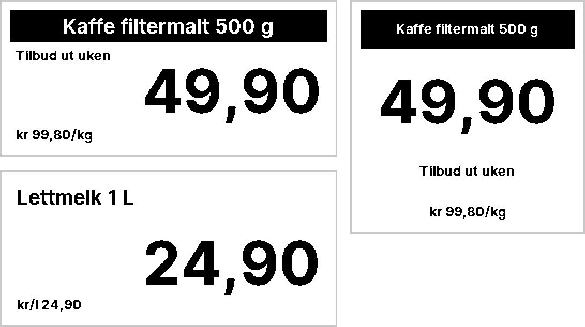
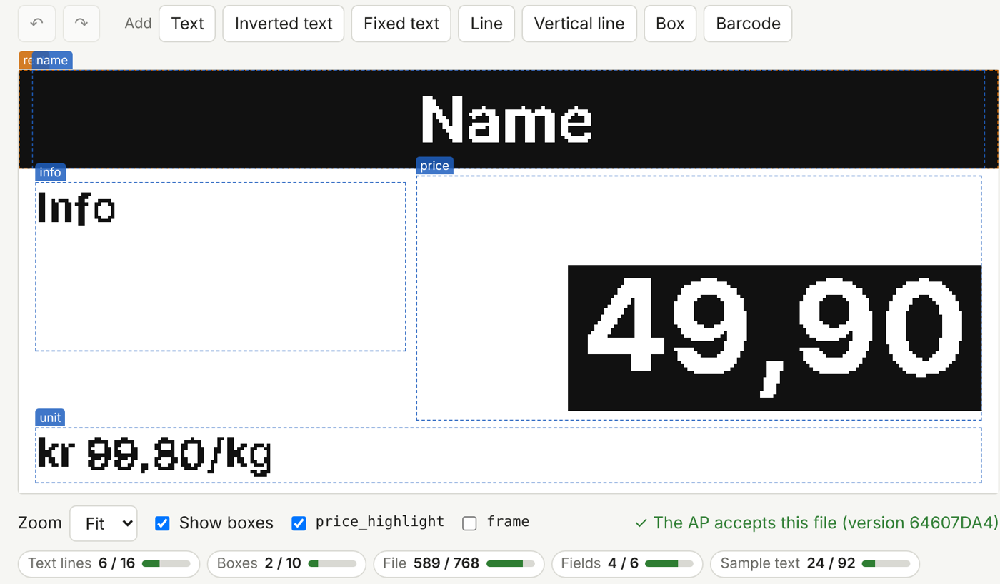
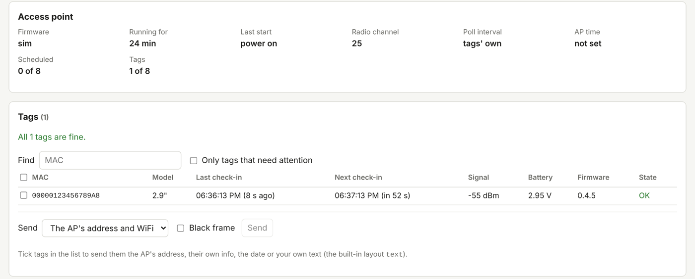

<h1 align="center">
   OpenESL
</h1>

<p align="center">
  Open firmware for SoluM e-paper shelf labels and an ESP32-C6 access point.<br>
  Put prices and text on the labels from any software, with one HTTP request.
</p>

<p align="center">
  <a href="https://github.com/mathiasbk/openESL/releases/latest"></a>
  <a href="https://github.com/mathiasbk/openESL/actions/workflows/web.yml"></a>
  <a href="LICENSE"></a>
</p>

<p align="center">
  <a href="https://mathiasbk.github.io/openESL/"><b>Web page</b></a> ·
  <a href="https://mathiasbk.github.io/openESL/#ap">Flash the AP</a> ·
  <a href="https://mathiasbk.github.io/openESL/#tag">Flash a tag</a> ·
  <a href="https://mathiasbk.github.io/openESL/#design">Label designer</a> ·
  <a href="https://mathiasbk.github.io/openESL/#api">API docs</a> ·
  <a href="https://github.com/mathiasbk/openESL/wiki">Wiki</a>
</p>

<p align="center">
  
  &nbsp;
  
</p>

## Features

- **SoluM e-paper labels** on the ZBS243 chip, 2.9" and 1.54" (and the 2.9" with red, experimental). More makers and models are welcome.
- **A plain HTTP API** on the access point, protected by a token, for scripts, web shops and home automation ([Home Assistant integration](https://github.com/mathiasbk/openesl-homeassistant), [OpenAPI](docs/openapi.yaml)).
- **Your own layouts**, drawn in the browser with a pixel-exact preview: text and your own fonts, barcodes, QR codes, pictures, dates and scheduled prices.
- **A dashboard** on the AP with every label's screen, signal, battery and firmware, and a webhook when something needs attention.
- **Updates without cables:** the AP updates itself over WiFi and passes new firmware to the labels over the radio.
- **Flashing from the browser** over Web Serial, with nothing to install, and **backup and restore** of everything the AP keeps.
- **A simulator** that runs the label firmware and the AP together on a PC, so you can try the API without any hardware.
- **Written from scratch** and released under the **[MIT licence](LICENSE)**.

## What you need

- One of the [supported labels](#supported-tags).
- An **ESP32-C6** board with USB as the access point. For more labels, other boards work too: see [Choosing an access point board](https://github.com/mathiasbk/openESL/wiki/Access-point-boards).
- A small **flasher** board (for example a Wemos D1 mini) and a pogo-pin jig for the test pads behind the battery: [Building the flasher](https://github.com/mathiasbk/openESL/wiki/Building-the-flasher).
- A desktop browser with Web Serial for flashing: Chrome, Edge, or Firefox 151 or newer.

The whole list, with links and prices, is on [What you need](https://github.com/mathiasbk/openESL/wiki/What-you-need).

## Supported tags

<!-- BEGIN models (Generated by tools/gen_models.py from shared/models.json. Do not edit; run the script.) -->
| Maker | Tag | Product | Screen | Colours | Chip | Radio | Status |
|---|---|---|---|---|---|---|---|
| SoluM | SoluM 2.9" black/white | ST-GM29XX2 | 296 × 128 | black/white | ZBS243 | 802.15.4 | Supported |
| SoluM | SoluM 1.54" black/white | ST-GM16XX2 | 200 × 200 | black/white | ZBS243 | 802.15.4 | Supported |
| SoluM | SoluM 2.9" black/white/red | ST-GR29000 | 296 × 128 | black/white/red | ZBS243 | 802.15.4 | Experimental |
<!-- END models -->

The list is made from [shared/models.json](shared/models.json). **Have a label that is not on the list?** [Suggest it in an issue](https://github.com/mathiasbk/openESL/issues/new?template=hardware.yml) with photos of the board and what is written on the chip and display, or see [Adding hardware](https://github.com/mathiasbk/openESL/wiki/Adding-hardware).

## Getting started

Everything is done from the web page at **[mathiasbk.github.io/openESL](https://mathiasbk.github.io/openESL/)**, which always serves the latest release. The step-by-step guide is [Getting started](https://github.com/mathiasbk/openESL/wiki/Getting-started) in the wiki.

1. **Flash the access point** on the [Flash AP](https://mathiasbk.github.io/openESL/#ap) tab, and give it your WiFi and an API token.
2. **Flash the labels** in the jig on the [Flash tag](https://mathiasbk.github.io/openESL/#tag) tab. Each label backs up its original firmware first.
3. **Design your layouts** on the [Design](https://mathiasbk.github.io/openESL/#design) tab, or use the built-in `price` and `text` layouts.
4. **Send content** from your own software:

```bash
curl -X PUT http://openesl.local/api/tags/00000123456789A8 \
  -H "Authorization: Bearer $TOKEN" \
  -d '{"layout": "price", "fields": ["Lettmelk 1 L", "24,90", "kr 24,90/L"]}'
```

The label shows it at its next check-in.

## Try it without hardware

The [simulator](sim/README.md) runs the label firmware and the AP together on a PC (Linux or macOS, with a C compiler and make):

```bash
make -C sim                                                # builds every label model and runs the tests
sim/build/154/esl-sim serve --speed 60 --png /tmp/screen.png  # a simulated AP with one label, 60 times faster than real time
```

`serve` prints the serial port it opened; [esl-client](tools/esl-client/README.md) talks to it as to a real AP, and the label's screen is saved to the PNG ([details](sim/README.md#serial-port-esl-sim-serve)).

## How it works



The AP keeps a few text fields per label and draws each label's screen from them; the label fetches the image when it changes. More on [How it works](https://github.com/mathiasbk/openESL/wiki/How-it-works).

<p align="center">
  
</p>

## Screenshots

**Label designer.** Drag and resize boxes on a pixel-exact preview and type the sample text next to each field ([Label designer](https://github.com/mathiasbk/openESL/wiki/Label-designer)).



**Dashboard.** The AP's state and every label, served by the AP itself at `http://openesl.local/` ([Dashboard](https://github.com/mathiasbk/openESL/wiki/Dashboard)).



## Status

OpenESL runs on real 2.9" and 1.54" labels, with the ESP32-C6 and the ESP32-S3 + C6 as access points. The features are tested on a PC and in CI, and most of them on real labels; what has not been tried on hardware yet is marked experimental here, in the wiki and in the [release notes](https://github.com/mathiasbk/openESL/releases). Coming from an older version? See [Upgrading from older versions](https://github.com/mathiasbk/openESL/wiki/Upgrading-from-older-versions). What comes next is on the [Roadmap](https://github.com/mathiasbk/openESL/wiki/Roadmap).

## For developers

| Folder | Contents |
|---|---|
| [web/](web/README.md) | Web page: label designer, dashboard, and flashing of tags and the AP from the browser |
| [ap/](ap/) | AP firmware (ESP-IDF) with the HTTP API, for the boards in [ap/boards](ap/boards/README.md), and the C6 radio in [ap/radio](ap/radio/README.md) |
| [tag/](tag/) | Tag firmware for the ZBS243 (SDCC, 8051) |
| [shared/](shared/) | `proto.h` (the radio packets) and `models.json` (the label models) |
| [sim/](sim/README.md) | Tag firmware and AP core together on the PC, with a simulated radio link |
| [tools/](tools/) | [`esl-client`](tools/esl-client/README.md) (client for the API, backup, OTA), [`flash-tui`](tools/flash-tui/README.md), [`wemos-debug`](tools/wemos-debug/README.md), `power-budget` |
| [docs/](docs/README.md) | Protocol, API, hardware notes and the release process |
| [wiki/](wiki/) | The user guide, published to the [GitHub wiki](https://github.com/mathiasbk/openESL/wiki) from master |
| [Jig/Hardware/](Jig/Hardware/README.md) | The flashing jig: BOM, photos and 3D-printed parts |

`python tools/check.py` builds and tests the same things as CI on your own machine ([Building from source](https://github.com/mathiasbk/openESL/wiki/Building-from-source)). How a change is made, tested and released is in [CONTRIBUTING.md](CONTRIBUTING.md) and [docs/release.md](docs/release.md). Security problems go to [SECURITY.md](SECURITY.md), not to an issue.

## Contributing

Help is welcome, most of all with hardware we have not tried yet: other labels (other SoluM sizes, other ZBS243 labels, other chips), other access point boards, and other flashers and jigs. Open an issue with what you have, or a pull request. Bug reports and fixes for everything else are just as welcome.

## A clean implementation

OpenESL is written from scratch. It does not contain code from other firmware for the same hardware, and it uses its own radio protocol. Third-party code is only used where its licence allows it (ESP-IDF, the Inter font, the QR encoder after Project Nayuki). Where each hardware fact comes from is listed in [docs/kildelogg.md](docs/kildelogg.md).

## Credits

This project would be much harder without the people who opened up these tags first:

- **Dmitry Grinberg** ([dmitry.gr](https://dmitry.gr)) for the reverse engineering of the ZBS243 and the SoluM tags.
- **atc1441** for [ZBS_Flasher](https://github.com/atc1441/ZBS_Flasher), the flasher used to read and write the tags, and for a lot of public research and videos on these tags.
- **Project Nayuki** for the [QR Code generator library](https://www.nayuki.io/page/qr-code-generator-library) (MIT) that our QR encoder follows.
- The **[OpenEPaperLink](https://github.com/OpenEPaperLink)** project and its contributors for documenting the tags, pinouts and flashing.

## Licence

OpenESL is released under the [MIT License](LICENSE). The Inter font in `tag/fonts/` keeps its own licence, the SIL Open Font License 1.1 ([tag/fonts/OFL.txt](tag/fonts/OFL.txt)), ESP-IDF and its components keep theirs (Apache-2.0), and the QR encoder in `ap/components/esl_core/esl_qr.c` follows Project Nayuki's [QR Code generator library](https://www.nayuki.io/page/qr-code-generator-library) (MIT, its notice is in the file).
