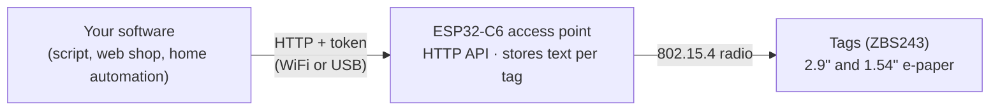

# OpenESL

<p align="center">
  
</p>

Open firmware for the SoluM ST-GM29XX2 (2.9") and ST-GM16XX2 (1.54") price tags (ZBS243) and an access point (AP) on the ESP32-C6. The AP exposes a small HTTP API, so any software can send price and text straight to the tags.

**Web page:** [mathiasbk.github.io/openESL](https://mathiasbk.github.io/openESL/) has the label designer, the flashers for tags and the AP, the dashboard, the setup guide and the API documentation, all in the browser.

## How it works



The AP is only an API. It does not know about products, shops or databases: it stores text fields per tag MAC and hands them to the tags. Anything that can make an HTTP request (a script, a web shop, a home automation system) can be a client.

```bash
curl -X PUT http://openesl.local/api/tags/00000123456789A8 \
  -H "Authorization: Bearer $TOKEN" \
  -d '{"layout": "price", "fields": ["Lettmelk 1 L", "24,90", "kr 24,90/L"]}'
```

The tag picks the new content up at its next poll and draws it with the built-in `price` layout, or with your own layouts from the designer. These are the tag's own drawings, from the firmware running on the PC in [sim/](sim/README.md):

<p align="center">
  
</p>

## The web page

**Design** draws the layout files for each tag model. The preview is drawn by the tag's own code built to WebAssembly, so it is what the tag will show, pixel for pixel, and the meters under it show how much of the tag's limits the layout uses.


**Dashboard** shows the AP's state and every tag (last poll, signal, battery, firmware, what it waits for), over USB or through the bridge in `tools/esl-client`, and sends new firmware to the AP and to the tags over the radio. The screenshot is of the simulator in [sim/](sim/README.md).


**Flash tag** and **Flash AP** put the firmware on the hardware over Web Serial, and **Set up** and **API** cover the first start and the HTTP API.

**Setting up the AP** (first start, WiFi, the API token): the Set up tab of the web page, [mathiasbk.github.io/openESL/#setup](https://mathiasbk.github.io/openESL/#setup). **API documentation:** the API tab of the web page, [mathiasbk.github.io/openESL/#api](https://mathiasbk.github.io/openESL/#api): interactive, with test requests against your own AP through `tools/esl-client` (`esl_client.py serve`). The reference is [docs/openapi.yaml](docs/openapi.yaml) (OpenAPI 3.1), checked against the AP code in CI. An example client is in [tools/esl-client](tools/esl-client/README.md).

## Hardware

| | |
|---|---|
| **Tags** | SoluM ST-GM29XX2 (2.9", 296 × 128) and ST-GM16XX2 (1.54", 200 × 200), black and white e-paper, ZBS243 (8051 with an 802.15.4 radio). The 1.54" takes one CR2450, the 2.9" two. Notes: [docs/st-gm16xx2.md](docs/st-gm16xx2.md). |
| **Access point** | Any ESP32-C6 board with USB. A board with a 0.96" LCD can show a status screen. |
| **Flashing tags** | A Wemos D1 mini with atc1441's [ZBS_Flasher](https://github.com/atc1441/ZBS_Flasher) and a pogo-pin jig on the test pads behind the battery. |

<table>
  <tr>
    <td align="center"><br><sub>1.54" board: ZBS243 and display connector</sub></td>
    <td align="center"><br><sub>1.54" back: test pads behind the CR2450</sub></td>
    <td align="center"><br><sub>2.9" back: two batteries, test pads</sub></td>
  </tr>
</table>

## Status

Working on hardware since 2026-10-14: the tag firmware runs on the SoluM 1.54" (ST-GM16XX2, ZBS243), and the ESP32-C6 AP serves it, with the API over USB and WiFi. Prices and text, layout files with barcodes, scheduled prices, per-tag settings, a health report with a webhook, OTA for the AP, backup and restore, and the web page with a label designer and browser flashers are in place and tested on a PC, in CI and (most of them) on the jig. The first release is v0.1.0. What is left, and what is still untried on hardware, is in [docs/fremdriftsplan.md](docs/fremdriftsplan.md).

## Folders

| Folder | Contents |
|---|---|
| [web/](web/README.md) | Web page: label designer, and flashing of tags and the AP from the browser |
| [docs/](docs/README.md) | Requirements, architecture, protocol, work plan, risks and hardware notes |
| [tag/](tag/) | Tag firmware for the ZBS243 (SDCC, 8051) |
| [ap/](ap/) | AP firmware for the ESP32-C6 (ESP-IDF) with the HTTP API |
| [shared/](shared/) | `proto.h`, shared packet definitions for tag and AP |
| [tools/](tools/) | [`esl-client`](tools/esl-client/README.md) (example client for the API), [`flash-tui`](tools/flash-tui/README.md) (flashing tags in a jig), [`wemos-debug`](tools/wemos-debug/README.md) (the tag's debug UART), `power-budget` ([docs/strombudsjett.md](docs/strombudsjett.md)) |
| [sim/](sim/README.md) | Tag firmware and AP core together on the PC, with a simulated radio link: end-to-end tests in CI, and a serial port for `esl-client` with no hardware |

Start with [docs/README.md](docs/README.md), then phase 0 in [docs/fremdriftsplan.md](docs/fremdriftsplan.md).

## Releases

The version is in [VERSION](VERSION). The tag firmware shows it on its start screen and sends it in POLL (1.2.3 as 10203), and the AP reports it as `ap.fw` in `GET /api/tags`.

To make a release, bump `VERSION` in a pull request. When it is merged to `master`, [release.yml](.github/workflows/release.yml) makes the release `v<VERSION>` from that commit: it builds the firmware and publishes a GitHub release with the tag firmware for each model, the merged AP image (plain, and with the LCD status screen), the app image alone for OTA (`...-ota.bin` for both, `esl-client ota`), `SHA256SUMS.txt`, and notes listing the pull requests since the previous release. The web page is then published again, and its flashers serve that release.

The same workflow can be started by hand (Actions → Release → Run workflow) to release the current `VERSION` if that release does not exist yet, or by pushing a tag that matches `VERSION` (`git tag v0.2.0 && git push origin v0.2.0`). A tag with a suffix (`v0.2.0-rc1`) becomes a pre-release, which the web page does not use.

Every pull request and push to `master` runs [web.yml](.github/workflows/web.yml): host tests, both tag models, the AP and the web page with its tests.

## A clean implementation

OpenESL is written from scratch. It does not contain code from other firmware for the same hardware, and it uses its own radio protocol. Third-party code is only used where its licence allows it (ESP-IDF, the Inter font). Hardware facts the code relies on, and where they come from, are listed in [docs/kildelogg.md](docs/kildelogg.md).

## Credits

This project would be much harder without the people who opened up these tags first:

- **Dmitry Grinberg** ([dmitry.gr](https://dmitry.gr)) for the reverse engineering of the ZBS243 and the SoluM tags.
- **atc1441** for [ZBS_Flasher](https://github.com/atc1441/ZBS_Flasher), the flasher used to read and write the tags, and for a lot of public research and videos on these tags.
- The **[OpenEPaperLink](https://github.com/OpenEPaperLink)** project and its contributors for documenting the tags, pinouts and flashing.

## Licence

Not decided yet.
