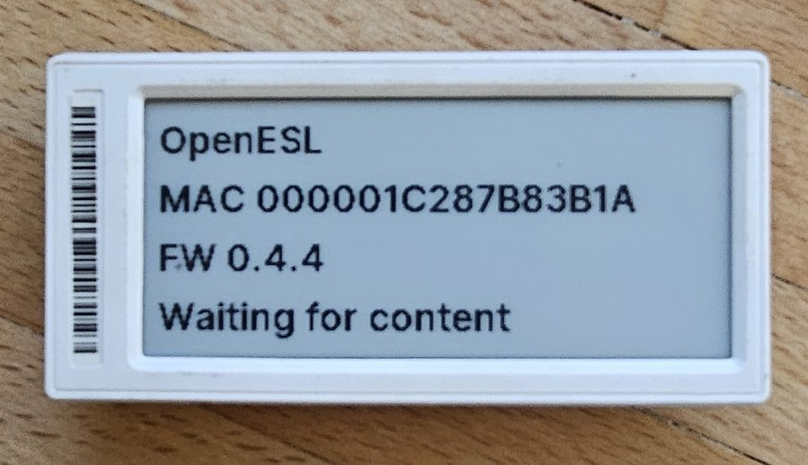
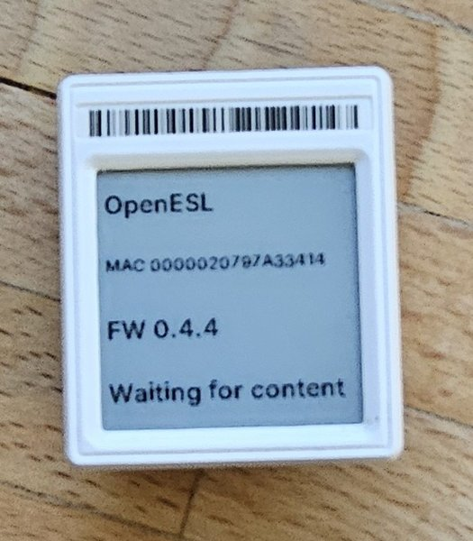
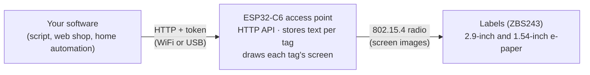
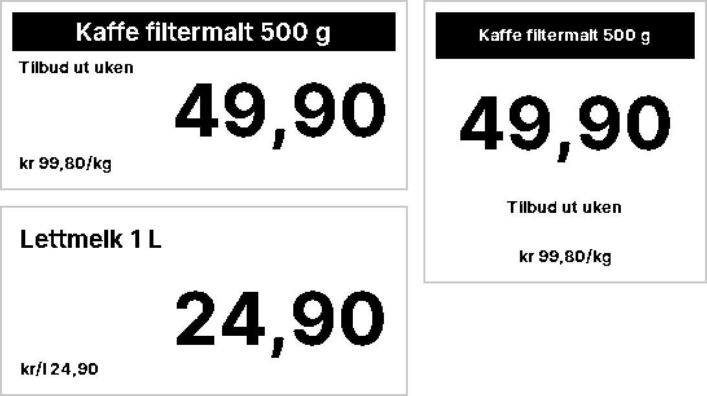
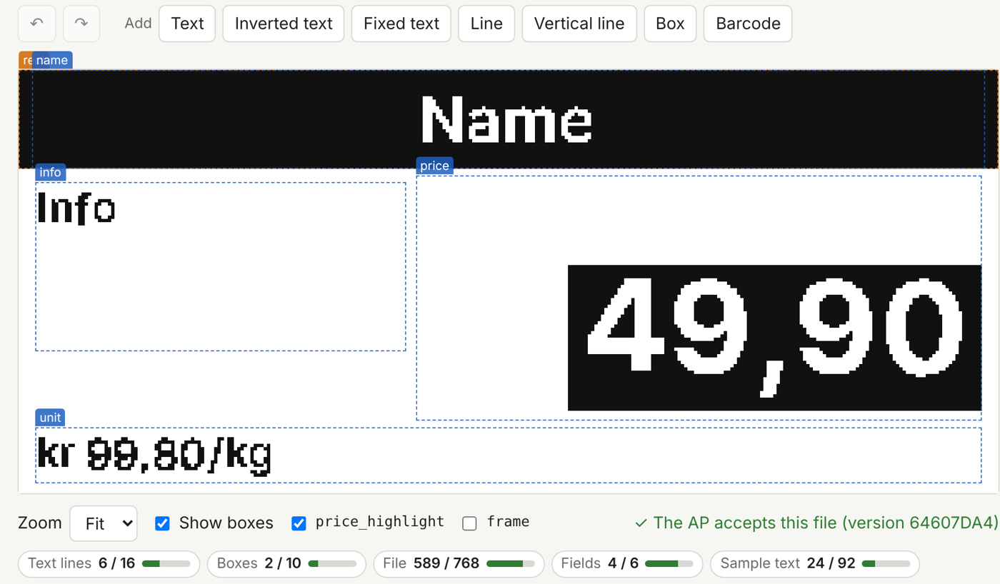
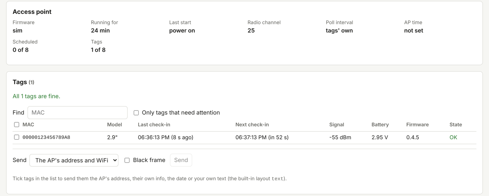
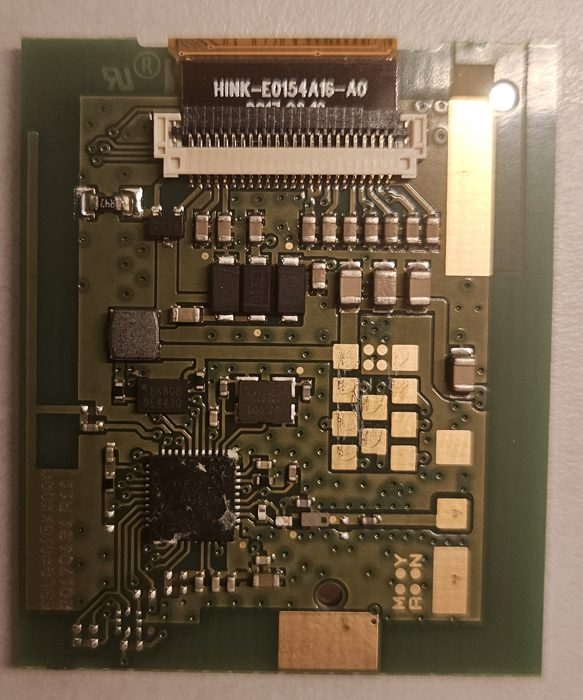
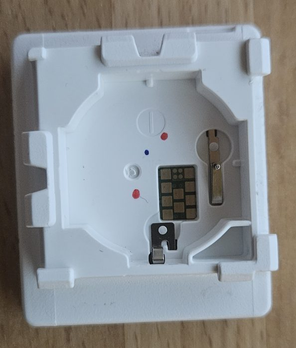
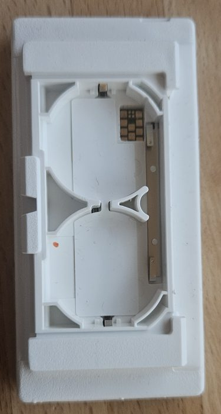

<h1 align="center">OpenESL</h1>

<p align="center">
  Open firmware for SoluM e-paper shelf labels and an ESP32-C6 access point.<br>
  Put prices and text on the labels from any software, with one HTTP request.
</p>

<p align="center">
  <a href="https://github.com/mathiasbk/openESL/releases/latest"></a>
  <a href="https://github.com/mathiasbk/openESL/actions/workflows/web.yml"></a>
  <a href="LICENSE"></a>
</p>

<p align="center">
  <a href="https://mathiasbk.github.io/openESL/"><b>Web page</b></a> ·
  <a href="https://mathiasbk.github.io/openESL/#ap">Flash the AP</a> ·
  <a href="https://mathiasbk.github.io/openESL/#tag">Flash a tag</a> ·
  <a href="https://mathiasbk.github.io/openESL/#design">Label designer</a> ·
  <a href="https://mathiasbk.github.io/openESL/#api">API docs</a>
</p>

<p align="center">
  
  &nbsp;
  
</p>

## Features

- **Two tag models:** SoluM ST-GM29XX2 (2.9", 296 × 128) and ST-GM16XX2 (1.54", 200 × 200), both on the ZBS243 chip.
- **A plain HTTP API** on the access point, protected by a token. Scripts, web shops and home automation can all be clients (example: [Home Assistant](docs/home-assistant.md)). Documented in [OpenAPI](docs/openapi.yaml) and checked against the code in CI.
- **Your own label layouts**, drawn in the browser: text in four sizes, inverted and highlighted text, lines, boxes and Code 128 or EAN-13 barcodes. The preview is the AP's own drawing code, so what you see is what the tag shows.
- **Scheduled prices** that switch at a time you choose, and **per-tag settings** such as the poll interval.
- **Firmware updates without cables (OTA):** the AP updates itself over WiFi, and passes new firmware to the tags over the radio, for one tag or a whole model at once.
- **A dashboard** on the AP itself, with every tag's screen as the AP draws it, its last and next check-in, signal, battery and firmware, and a health report that can call a webhook when something needs attention.
- **Flashing from the browser:** tags and the AP are flashed from [the web page](https://mathiasbk.github.io/openESL/) over Web Serial, with nothing to install. The tag's original firmware is backed up first.
- **Backup and restore** of the AP's tags, layouts and settings, so you can move to a new AP.
- **A simulator** that runs the tag firmware and the AP together on a PC, so you can try the API without any hardware.
- **Written from scratch** and released under the **[MIT licence](LICENSE)**.

## What you need

| Part | What to get |
|---|---|
| **Labels** | SoluM ST-GM29XX2 (2.9") or ST-GM16XX2 (1.54"). The 1.54" runs on one CR2450 battery, the 2.9" on two. |
| **Access point** | Any ESP32-C6 board with USB. A board with a 0.96" LCD also shows a status screen. An ESP32-C5 build (16 MB flash, 8 MB PSRAM) is there too, but not tried on a board yet ([ap/boards](ap/boards/README.md)). |
| **For flashing labels** | A small board running atc1441's [ZBS_Flasher](https://github.com/atc1441/ZBS_Flasher), and a pogo-pin jig for the test pads behind the battery. OpenESL is tested with a Wemos D1 mini, but ZBS_Flasher also runs on an ESP32 or an Arduino Nano, and on most boards with about eight free pins and a serial port. |
| **A browser** | A desktop browser with Web Serial for flashing: Chrome, Edge, or Firefox 151 or newer. The designer works in any modern browser. |

## Getting started

Everything is done from the web page at **[mathiasbk.github.io/openESL](https://mathiasbk.github.io/openESL/)**, which always serves the latest release.

1. **Flash the access point** on the [Flash AP](https://mathiasbk.github.io/openESL/#ap) tab, then give it your WiFi and an API token over the same USB cable.
2. **Flash the labels** one at a time in the jig on the [Flash tag](https://mathiasbk.github.io/openESL/#tag) tab. Each label backs up its original firmware, then starts polling the AP.
3. **Design your layouts** on the [Design](https://mathiasbk.github.io/openESL/#design) tab and send them to the AP, or start with the built-in `price` and `text` layouts.
4. **Send content** from your own software:

```bash
curl -X PUT http://openesl.local/api/tags/00000123456789A8 \
  -H "Authorization: Bearer $TOKEN" \
  -d '{"layout": "price", "fields": ["Lettmelk 1 L", "24,90", "kr 24,90/L"]}'
```

The label picks the new content up at its next poll. The [Set up](https://mathiasbk.github.io/openESL/#setup) tab covers the first start, WiFi and the token in detail, and the [API](https://mathiasbk.github.io/openESL/#api) tab lets you try every request against your own AP through the bridge in [tools/esl-client](tools/esl-client/README.md).

## How it works



The access point knows nothing about products, shops or databases. It keeps a few text fields per label MAC and draws each label's screen from them with the layout you chose. When a label polls and shows something else, the AP sends it the screen as a 1-bit image; the label stores it in its SPI flash and shows it. These screens are from the simulator in [sim/](sim/README.md):

<p align="center">
  
</p>

## Screenshots

**Label designer.** Drag and resize boxes on a pixel-exact preview. The meters underneath show how much of the AP's layout limits the layout uses.



**Dashboard.** The AP's state and every label, refreshed every 10 seconds. The AP serves it itself at `http://openesl.local/dashboard`, and the web page reaches it over USB or the bridge. (The screenshot is from the simulator.)



## Hardware

<table>
  <tr>
    <td align="center"><br><sub>1.54" board: ZBS243 and display connector</sub></td>
    <td align="center"><br><sub>1.54" back: test pads behind the CR2450</sub></td>
    <td align="center"><br><sub>2.9" back: two batteries, test pads</sub></td>
  </tr>
</table>

Hardware notes, pinouts and where each fact comes from are in [docs/](docs/README.md), for example [docs/st-gm16xx2.md](docs/st-gm16xx2.md).

## Status

Running on real hardware: the 1.54" since 2026-10-14 and the 2.9" since 2026-10-17, both served by the ESP32-C6 AP over USB and WiFi. The features above are tested on a PC and in CI, and most of them on real labels. What is left, and what has not been tried on hardware yet, is in [docs/fremdriftsplan.md](docs/fremdriftsplan.md).

Tag firmware 0.4.7 and older draws the screen itself and does not take the AP's images, so every tag needs the new tag firmware: over the radio (`esl-client tag-ota`, or the dashboard) if it has the bootloader (0.3.0 and newer), otherwise in the jig ([tag/README.md](tag/README.md)).

## Folders

| Folder | Contents |
|---|---|
| [web/](web/README.md) | Web page: label designer, and flashing of tags and the AP from the browser |
| [docs/](docs/README.md) | Requirements, architecture, protocol, work plan, risks and hardware notes |
| [tag/](tag/) | Tag firmware for the ZBS243 (SDCC, 8051) |
| [ap/](ap/) | AP firmware for the ESP32-C6 (ESP-IDF) with the HTTP API |
| [shared/](shared/) | `proto.h`, shared packet definitions for tag and AP |
| [tools/](tools/) | [`esl-client`](tools/esl-client/README.md) (example client for the API), [`flash-tui`](tools/flash-tui/README.md) (flashing tags in a jig), [`wemos-debug`](tools/wemos-debug/README.md) (the tag's debug UART), `power-budget` ([docs/strombudsjett.md](docs/strombudsjett.md)) |
| [sim/](sim/README.md) | Tag firmware and AP core together on the PC, with a simulated radio link: end-to-end tests in CI, and a serial port for `esl-client` with no hardware |
| [Jig/Hardware/](Jig/Hardware/README.md) | The flashing jig: ZBS_Flasher on a D1 mini, BOM, photos and 3D-printed parts |

Start with [docs/README.md](docs/README.md), then phase 0 in [docs/fremdriftsplan.md](docs/fremdriftsplan.md).

## Releases

The release's version is in [VERSION](VERSION). The AP firmware and the firmware of each tag model carry the version of the release they last changed in, worked out by [tools/fw_version.py](tools/fw_version.py) from the release tags (`python3 tools/fw_version.py --all`): a release that changes only the AP, or only one tag model, gives the other tags the same firmware as before, with the same version, so the dashboard offers them nothing and no tag downloads an update over the radio for no reason. Nothing is bumped by hand; the script lists which files belong to which part. The tag firmware shows its version on its start screen and sends it in POLL (1.2.3 as 10203), and the AP reports its own as `ap.fw` in `GET /api/tags`. A checkout without the release tags (a download of the sources, a shallow clone) builds with the version in `VERSION`. The AP build and the simulation read the version when they configure: after new tags or source changes, a local build that only recompiles keeps the earlier version until `idf.py reconfigure` or a clean build.

To make a release, bump `VERSION` in a pull request. When it is merged to `master`, [release.yml](.github/workflows/release.yml) makes the release `v<VERSION>` from that commit: it builds the firmware and publishes a GitHub release with the tag firmware for each model, the merged AP image for a new board, one per board in [ap/boards](ap/boards/README.md) (written at 0x0 it erases what an AP in use has stored, see [ap/README.md](ap/README.md#build-and-flash)), the app image alone for OTA (`...-ota.bin` for each board, `esl-client ota`), `SHA256SUMS.txt`, and notes from [tools/release_notes.py](tools/release_notes.py): the pull requests since the previous release sorted by what they changed (AP firmware, tag firmware, web page, the rest), with the version each firmware carries and "unchanged" where nothing was. The files are named after the release even when a part is unchanged. The same script writes the body of the release pull request: `python3 tools/release_notes.py v0.4.5 origin/development`. The web page is then published again, and its flashers serve that release.

The same workflow can be started by hand (Actions → Release → Run workflow) to release the current `VERSION` if that release does not exist yet, or by pushing a tag that matches `VERSION` (`git tag v0.2.0 && git push origin v0.2.0`). A tag with a suffix (`v0.2.0-rc1`) becomes a pre-release, which the web page does not use.

Every pull request and push to `master` runs [web.yml](.github/workflows/web.yml): host tests, both tag models, the AP and the web page with its tests.

## Building and testing locally

`python tools/check.py` builds and tests the same things as CI, on your own machine, and puts the firmware in `out/` with the names CI gives it. `--list` shows the steps; name some to run only those (`python tools/check.py tag web`). A step whose tools are missing is skipped and says what it needs.

- **Linux or WSL:** run `tools/dev/setup.sh` once. It installs SDCC 4.5.0, Emscripten 3.1.74 (and Node 22 if needed) into `~/.cache/openesl`, and the Python packages. The AP firmware is built with `idf.py` if ESP-IDF v5.5.5 is active in the shell, otherwise in the `espressif/idf:v5.5.5` Docker image.
- **Windows or macOS:** with Docker Desktop running, `python tools/check.py --docker` runs every step in one image with all the toolchains ([tools/dev/Dockerfile](tools/dev/Dockerfile)). The first run builds the image.

## A clean implementation

OpenESL is written from scratch. It does not contain code from other firmware for the same hardware, and it uses its own radio protocol. Third-party code is only used where its licence allows it (ESP-IDF, the Inter font). Hardware facts the code relies on, and where they come from, are listed in [docs/kildelogg.md](docs/kildelogg.md).

## Contributing

Help is welcome, and most of all with hardware we have not tried yet:

- **Other labels:** more SoluM sizes and models, other labels built on the ZBS243, and labels with other chips too. Photos of the board, the chip and display type, and a flash backup are a good start.
- **Other access points:** other ESP32 boards, or radios other than the ESP32-C6.
- **Other flashers:** boards and jigs other than the Wemos D1 mini and our pogo-pin jig.

Open an issue with what you have, or a pull request. Bug reports and fixes for everything else are just as welcome.

How a change is made, tested and released is in [CONTRIBUTING.md](CONTRIBUTING.md); the release steps and checklist are in [docs/release.md](docs/release.md). Security problems go to [SECURITY.md](SECURITY.md), not to an issue.

## Credits

This project would be much harder without the people who opened up these tags first:

- **Dmitry Grinberg** ([dmitry.gr](https://dmitry.gr)) for the reverse engineering of the ZBS243 and the SoluM tags.
- **atc1441** for [ZBS_Flasher](https://github.com/atc1441/ZBS_Flasher), the flasher used to read and write the tags, and for a lot of public research and videos on these tags.
- The **[OpenEPaperLink](https://github.com/OpenEPaperLink)** project and its contributors for documenting the tags, pinouts and flashing.

## Licence

OpenESL is released under the [MIT License](LICENSE). The Inter font in `tag/fonts/` keeps its own licence, the SIL Open Font License 1.1 ([tag/fonts/OFL.txt](tag/fonts/OFL.txt)), and ESP-IDF and its components keep theirs (Apache-2.0).
