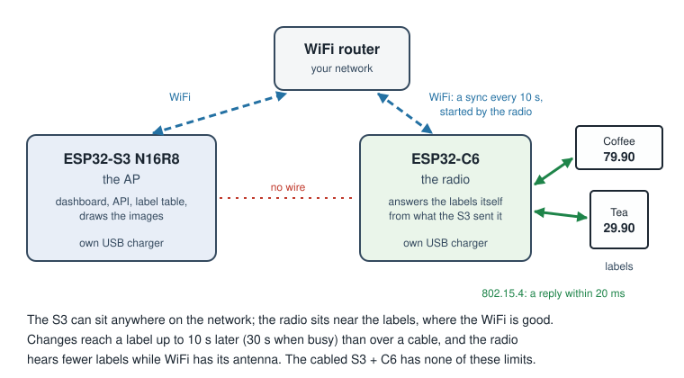

# AP with a wireless radio (ESP32-S3 + ESP32-C6 over WiFi)

A separate AP setup, not a variant of [the S3 with a C6 on a cable](ap-radio-link.md): the ESP32-S3
runs the AP, and the ESP32-C6 that talks to the tags sits somewhere else on the same WiFi network,
each on its own power supply, with no wire between them. Short name in code and file names: `netradio`.

**Status: experimental, not secure yet.** Both ends have firmware: the S3 board `s3-n16r8-netradio` and the
radio in `ap/netradio/`. It has run on one S3 and one C6 with two tags (below, "On hardware"), and new
prices reached both screens. It is not in a release. **The link is plain TCP without a password**: any
device on the network can connect to the S3 as its radio, or answer the radio as its AP. Use it only on a
network you trust until pairing and TLS are done (step 3d, at the end).

**Read the limits first.** The setup works only because the radio answers the tags on its own and uses
WiFi as little as it can. That has costs the cabled S3 + C6 does not have. If the radio can sit next to
the S3, the cable is better in every way; the wireless radio is for when it cannot.

## Limits

These come from measurements on a C6 (below), not from guesses. They are what to expect, and what to
tell anyone who picks this setup.

- **Changes reach a tag later.** The radio syncs with the S3 every 10 s, and 1 s after a tag it lacked
  something for. It waits for a quiet moment between tags, so when the tags keep it busy a sync can
  slip, up to 30 s; then it syncs anyway, and a tag in the middle of an image may lose a reply and try
  again. A new price is drawn on the S3, sent to the radio at its next sync, and shown when the tag next
  wakes up: on top of the tag's interval, add up to 10 s (about 5 s on average), and up to 30 s when the
  tags are busy.
- **Images and firmware go over WiFi in the pauses, and cost tag replies while they do.** The radio
  fetches what it lacks in one go at a sync. An image is a few KB (about 5 KB for a 2.9" screen),
  firmware for a tag model about 53 KB. That is many WiFi packets in a row, and while they go the radio
  hears almost no tags: with steady traffic about 40 % of frames were lost in the measurements.
  **How long a sync takes** (measured on one radio, "On hardware" below): 100–160 ms with nothing new
  (up to about 0.3 s), and up to 4.6 s while images went over. Of 66 tag replies, the 5 that failed all
  failed while images were on the way (WiFi had the radio, "coexist" errors); with only polls, none did.
  Tag firmware takes longer still and is not measured yet, so it rolls out more slowly than with a
  cabled radio; the radio also writes it to its flash, and the C6 stands still for each 4 KB erase
  (about 14 for one model).
- **A change to every tag at once takes minutes.** A sync sends at most 4 images, and syncs come 1 s
  apart while more is waiting, so 1000 tags with new prices take about 250 syncs: roughly 4 minutes of
  image traffic or more (an estimate), during which many first replies are lost and tags retry. The
  images of tags that are polling go first, then, while the radio has slots to spare, those of tags
  that will poll later. A radio with few image slots gets most images only when their tag polls, so the
  last tags show the change up to an interval or two later.
- **The dashboard is behind.** "Last seen", battery, RSSI and whether an image arrived come in batches
  with each sync, so they can be up to 30 s old. The tag table on the S3 is right, only late.
- **WiFi costs tag replies.** The C6 has one 2.4 GHz radio for WiFi and 802.15.4. Every WiFi exchange,
  even one small packet, takes it from the tags for about 80–95 ms, and a tag listens only 20 ms for a
  reply. With one packet every 5 s, 2.6 % of first replies were lost (the tag tries once more, so
  very few wake-ups fail entirely); with several packets a second, about 40 % are lost and the setup is
  useless. So the radio decides when WiFi is used: the S3 never sends on its own, it only answers
  (no pings or keepalives from the S3, TCP keepalive off), and nothing else may talk to the radio over
  WiFi: no dashboard, no API. Broadcasts on the network (ARP, other devices' mDNS) reach it anyway;
  they are part of the 0.6–1.4 % lost with no traffic at all.
- **Coex must stay at the driver's default.** Giving 802.15.4 a higher priority kills WiFi (measured),
  because the radio listening between frames counts as busy. There is nothing to tune here.
- **It needs good WiFi where the radio sits.** A weak signal means a lower bit rate, so every packet
  is longer on the air and takes longer from the tags. Measured at −74 to −77 dBm; better is better.
- **More tags, more retries.** The radio syncs only between tags. With many tags the quiet gaps get
  short, syncs fall more often on a tag's reply, and more tags need their second try. Not measured with
  many tags yet.
- **A tag the radio has nothing for polls more often.** When the radio lacks something for a tag (a tag
  it has not heard of, or an image or firmware it has not got yet) it tells the tag to come back in 5 s
  and asks the S3 at the next sync. That costs the tag battery until the radio has it, normally one or
  two wake-ups. After 3 such replies in a row the tag gets its usual interval again, so a radio that
  cannot get what it lacks (its table is full, an image too large for it) does not keep a tag awake.
- **When WiFi or the S3 is gone, the tags see the old state.** The radio keeps answering from what it
  has: the image it was told about, the interval, the settings. Nothing new reaches the tags, and if the
  outage is long, the oldest log entries are dropped (counted), so the S3 misses some battery readings
  and "last seen" times.
- **Memory on the C6.** The radio holds the state of every tag it serves, a few images, its log, and the
  tag firmware per model in its flash (16 models). It holds 500 tags by default
  (`CONFIG_ESL_NETRADIO_TAGS`); tags beyond that get the default interval and no content, and the S3
  logs a warning when it has more tags than its radio holds. How many tags one radio can serve well is
  not measured yet.
- **Not secure yet.** Plain TCP, no password: see "Status" above.
- **Two chips to update.** The S3 updates over the air as always; the radio is flashed separately (from
  the web page or with esptool) until the S3 can update it.

## How it works

Over the cable the radio forwards every frame and the S3 replies within a few ms. Over WiFi a round trip
takes 22–110 ms, so that cannot work. Instead:

1. **The radio answers every tag itself**, from a cache the S3 fills beforehand (`esl_rcache`): per tag
   the interval, the settings, the image it should show and the firmware version to offer, plus the
   images and firmware themselves. It picks the reply the way `esl_radio_handle()` does on the S3, in
   the same order (CONFIG, then the image, then firmware, else IDLE), and remembers a tag that failed
   to draw an image or rolled back firmware, so it does not offer that again.
2. **It logs every frame it got.** At each sync the S3 fetches the log and runs it through
   `esl_radio_handle()`, so its tag table ends up as if it had heard the tags itself, only later.
3. **The radio decides when to use WiFi** (`esl_rcache_sync_due()`): only when no tag frame has come for
   60 ms (300 ms while a tag is in the middle of an image), every 10 s when nothing is missing, 1 s after
   a tag it lacked something for, and at 30 s whatever the tags are doing. The S3 never starts an
   exchange.
4. **A sync** (`esl_rcache_sync_req()` on the radio, `esl_rhost` on the S3): the radio sends its log, its
   clock, what it lacks and which images and firmware it holds. The S3 replays the log at the times the
   frames came (turned into its own clock), then answers with what changed since it last told the radio:
   the state of every tag that differs (also tags that did not poll, so new content is waiting at the
   radio before the tag wakes up), the images the radio lacks for them, tag firmware for a model a tag
   is to get, the default interval, and the tags deleted since. Images go only to tags that do not
   show them yet and have not refused them: first for the tags the radio lacked something for (they are
   awake), then for others while the radio has free slots. Drawing is the slow part, so one sync draws
   at most 8 images and sends at most 4; with more waiting the S3 says so, and the rest follow at the
   next syncs, 1 s apart. The replay draws nothing.
5. **Nothing is lost on a broken link.** Every answer has a number that the radio acknowledges in its
   next sync, and every log entry has one too. When an answer did not arrive whole, the radio sends its
   log again (the S3 skips what it replayed already) and the S3 tells it everything again, after the
   radio forgets its tags. The same happens when the radio restarted (a new boot number) or the S3 did
   (it does not know the radio yet), so a tag deleted meanwhile is gone from the radio too. Telling it
   everything again costs one larger sync: about 40 bytes per tag (some 40 KB for 1000 tags), plus
   the images the radio lacks as tags ask for them.

The S3 runs the same AP firmware as with the cable, with the tag store, rendering, dashboard and API.
Only the link to the radio differs.

## Setting it up

The web page's Flash AP tab does all of this: pick "S3 + C6 over WiFi", and it flashes the C6 radio
and the S3, gives the S3 its WiFi and token over USB, then sends the C6 `ssid`, `pass`, `host` (the
S3's address if you type it, else empty so the C6 finds the S3 on mDNS) and `reboot` over the
C6's USB console, and reads the C6's log until it says `connected to the AP at ...`, then `status`
for the WiFi signal at the C6 (it warns below −75 dBm). It erases the C6 before it flashes it: the
radio keeps nothing it does not get again here. By hand:

1. Build and flash the S3 as any AP board: `python ap/build.py s3-n16r8-netradio` (which also builds the
   radio), then flash the S3 as in [ap-firmware.md](ap-firmware.md). It waits for the radio on TCP port
   4553 and announces itself on mDNS as `_openesl-ap._tcp`.
2. Flash the C6 with `out/openesl-ap-netradio-c6.bin` at 0, or from `ap/netradio/build/` with
   `esptool.py --chip esp32c6 write_flash @flash_args`. Its NVS sits where the AP's does, so a C6 that
   was an AP keeps its WiFi network and gets it back when it is flashed as an AP again. A C6 whose old
   app lay where this NVS is (anything that is not the AP) needs that area erased first:
   `esptool.py erase_region 0x9000 0x75000`.
3. Open the C6's USB port in a serial terminal and type, one line each: `ssid <network>`,
   `pass <password>`, `reboot`. It joins the network, finds the S3 on mDNS and connects. If it does not
   find it, give the S3's address: `host 192.168.1.50`. It then tries that address first and mDNS when
   it does not answer (the S3 got another address from the router, say); `host` alone clears it. `status` shows
   the radio, the cache and the link; it is also logged every minute.

The radio takes the channel and PAN from the S3 when it connects, and keeps them for its next start.

## On hardware

One ESP32-S3 N16R8 and one ESP32-C6 on the same WiFi network (RSSI −72 to −79 dBm at the C6),
two tags (1.54" and 2.9"), 14 minutes, 2026-10-24:

| | |
|---|---|
| Syncs | 78, none broken off, one connection all along |
| Sync with nothing new | 100–160 ms, up to 323 ms |
| Longest sync | 1.4 s before the images, 4.6 s while they went over |
| Tag replies | 66, 5 not sent (all during the image transfer, WiFi had the radio), 30 resends |
| New price on the 2.9" | drawn on the S3 after 2 s, on the screen after 90 s (mostly waiting for the tag's next poll) |
| Free heap on the C6 | about 164 KB, steady |

Found on the way: the S3 ran out of sockets for the web server while a browser kept five connections
open (fixed: 16 sockets on this board).

## Measurements

C6 on WiFi with 802.15.4 sending one frame every 50 ms, retried within 12 ms like the AP, on channel 20,
WiFi RSSI −74 to −77 dBm, coex at the default, power save MIN (MAX made no difference).

| UDP packets per second to the C6 | 802.15.4 frames not sent |
|---|---|
| 0 | 0.6–1.4 % |
| 0.2 (one every 5 s) | 2.6 % |
| 1 | 8–9 % |
| 5 | 37 % |
| 20 | 36–39 % |

- WiFi holds the radio in stretches of 50–80 ms, so a retry within 12 ms rarely saves a frame.
- UDP round trip: median 22–26 ms under traffic, 70–110 ms when the C6 has been idle (it has to wake).
- Without power save (PS NONE) about half the frames were lost even with no traffic.
- Coex priority H or M for 802.15.4: every frame went out, and WiFi died (no traffic, or no connection).

## Plan

| Step | What | Status |
|---|---|---|
| 1 | Measure WiFi against 802.15.4 on the C6 | done (above) |
| 2a | The radio's reply cache and log, tested against fake tags on the PC | done |
| 2b | The S3 side: build each tag's state from the store, replay the log (`esl_rhost`), tested end to end with the cache and fake tags | done |
| 3a | The link protocol (`esl_nlink`), tested on the PC end to end through a byte stream | done |
| 3b–c | Firmware for both ends: the S3 a TCP server announced on mDNS (`_openesl-ap._tcp`), the C6 joins WiFi, connects and syncs; set-up on the radio's USB console | done, tried on one S3 + C6 with two tags |
| 3d | Security: pairing with a code from the dashboard, TLS-PSK, a "Radios" tab | |
| 4 | Tag firmware kept in the radio's flash, so the S3 does not send it for every tag | |
| 5 | Several radios per S3: each tag owned by the radio that hears it best, never switched mid-image | |

Release files will have their own names so they are not mixed up with the cabled radio:
`openesl-ap-esp32s3-n16r8-netradio-<version>.bin` and `openesl-ap-netradio-esp32c6-<version>.bin`.

**Alternative: Ethernet.** A C6 with a W5500 (SPI Ethernet, possibly PoE) uses no 2.4 GHz for the link,
so none of the WiFi limits above apply and the replies might even come from the S3 as over the cable (not measured). It
needs a cable to a switch instead of to the S3.
