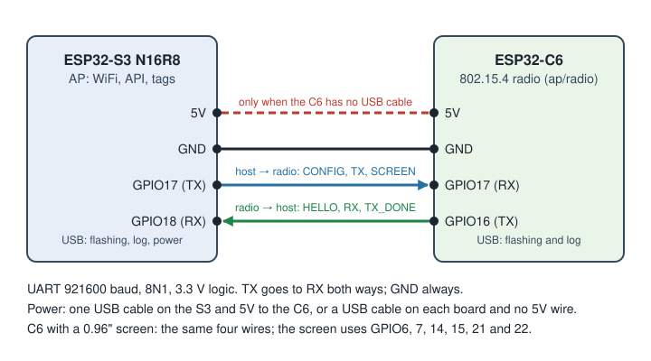

# AP with a separate radio chip (ESP32-S3 + ESP32-C6)

The AP normally runs on one ESP32-C6, which does WiFi and 802.15.4 on the same radio by
time-division and has 512 KB of RAM. For more tags, the AP can instead run on an
ESP32-S3 with PSRAM, with an ESP32-C6 next to it as a pure 802.15.4 radio
([issue #146](https://github.com/mathiasbk/openESL/issues/146), risiko.md R4).

| Chip | Firmware | Does |
|---|---|---|
| ESP32-S3 N16R8 (host) | AP firmware, board `s3-n16r8-c6` (`openesl-ap-esp32s3-n16r8-<version>.bin`) | WiFi, HTTP API, dashboard, tag store, rendering, `esl_radio_handle()`: everything the C6 AP does, up to 1000 tags |
| ESP32-C6 (radio) | `ap/radio/` (`openesl-ap-radio-esp32c6-<version>.bin`) | 802.15.4 only, no WiFi: forwards every frame to the host and sends the replies |
| ESP32-C6 with 0.96" screen (radio) | `ap/radio/`, radio board `c6-lcd` (`openesl-ap-radio-esp32c6-lcd-<version>.bin`) | the same, and shows the status the host sends (SCREEN) on its screen |

Status: supported with a plain ESP32-C6 Super Mini as the radio. Tried on 2026-10-26 with an
ESP32-S3 N16R8: four tags online, polls answered in about 2.3 ms (`replies.worst_us` 2302), the S3
updated over WiFi and the radio over the cable (twice, about 8 s each). The C6 with screen as the
radio is experimental: its image builds, but it is not tried yet.

For a C6 elsewhere on the WiFi network with no wire to the S3, a separate setup with other limits, see [ap-netradio.md](ap-netradio.md).

## Wiring

| ESP32-S3 | ESP32-C6 (Super Mini) |
|---|---|
| GPIO17 (TX) | GPIO17 (RX) |
| GPIO18 (RX) | GPIO16 (TX) |
| GND | GND |
| 5V | 5V, only when the C6 has no USB cable of its own |

The pins can be changed in menuconfig: `ESL_COPROC_TX_GPIO`/`ESL_COPROC_RX_GPIO` on both sides.
Both chips keep their USB port for flashing and the log. The C6 with screen is wired the same way: its screen uses GPIO 6, 7, 14, 15, 21 and 22.

## Flashing

1. The C6: `openesl-ap-radio-esp32c6-<version>.bin` at 0 (`esptool --chip esp32c6 write_flash 0 ...`),
   or `openesl-ap-radio-esp32c6-lcd-<version>.bin` for a C6 with the 0.96" screen.
   Its log says `OpenESL 802.15.4 radio`, and once the host runs, `channel .., PAN ..`.
2. The S3: `openesl-ap-esp32s3-n16r8-<version>.bin` at 0. Its log says `radio 1.1 up on
   channel ..` when it reaches the C6, and `no answer from the radio` every two seconds when it
   does not (check TX/RX crossed and GND). The log goes to the S3's USB-Serial/JTAG port
   (`CONFIG_ESP_CONSOLE_USB_SERIAL_JTAG`); its UART0 (the COM port) shows only the ROM's boot text.

### Checking the link from the C6

The C6's log on its own USB port tells which direction fails. The host sends CONFIG every 2 s
while the link is down (`CONFIG_EVERY_US` in `ap/main/radio_uart.c`), the radio logs `channel ..,
PAN ..` for each CONFIG and answers with HELLO, and the host stops once it hears the HELLO.

| The C6's log | Means |
|---|---|
| `channel .., PAN ..` once, then the stats line every 60 s | both directions work |
| no `channel` line, and `rx 0 ... link errors 0` | not a byte from the host reaches the C6's RX (GPIO17): open wire, no GND, or TX/RX swapped. `link errors` counts bad CRCs too, so 0 means a silent line, not a noisy one |
| `channel ..` every 2–3 s | host → radio works, radio → host does not: the C6's GPIO16 does not reach the S3's GPIO18 |

All three were seen on the first setup: TX and RX swapped, a loose GND, and the C6's TX in the
S3's GPIO16. Since 0.8.2 `GET /api/ota` says whether the AP hears its radio (`radio.up`) and what
it runs; `ap.replies.polls` in `GET /api/tags` going up when a tag wakes shows the whole chain
works.

The web page's Flash AP tab flashes both ("S3 + C6 on cable", with a plain C6 or one with the
screen): the C6 radio image first, then the S3 on its port marked USB, then it shows the wiring.
The dashboard updates the S3 over the API like any AP, and since 0.8.2 the C6 too, through the
S3 and the cable (below).

## Updating the radio over the cable

Since 0.8.2 the release has `openesl-ap-radio-esp32c6-<version>-ota.bin` (and `-lcd-`), and the
S3 passes it on to the C6: send it like AP firmware, with `POST /api/ota` (`esl-client ota
openesl-ap-radio-esp32c6-<version>-ota.bin --wait`), or from the dashboard, which shows the
radio's version under Firmware and an arrow button when the page has a newer one. No USB cable
and no BOOT or RESET pin: the C6 Super Mini has neither on its pins.

- The S3 sees the image's project name (`esl_radio`) and sends it on over the link as it
  arrives, in parts of 128 bytes, each answered by the C6 once it is in flash (OTA_* below). The
  S3 itself keeps running. About 290 KB take some 10–20 s.
- The C6 writes the app slot it does not run from (it has two since 0.8.2, `ap/radio/partitions.csv`),
  and restarts into it after the last part.
- The new radio firmware is kept once the S3 configures it (CONFIG), which shows the link works
  both ways. If that does not happen within 60 s, the C6 goes back to the old one by itself,
  so a bad image costs a restart, not a USB cable.
- The C6 takes only `esl_radio` images, and the S3 sends one only when its radio speaks link v2.

**Once over USB:** a C6 flashed before 0.8.2 has one app slot and link v1 (`radio.ota` false in
`GET /api/ota`). It keeps working with a newer S3, but it has to be flashed once more from the
Flash AP tab (which erases the radio's flash anyway) to get the two slots. After that it takes
every update over the cable. Mind the image: a radio with the screen needs the `-lcd` one
(`radio.display` in `GET /api/ota`).

## When the S3 loses the C6

The S3 shows whether it hears the C6 in `GET /api/tags` (`ap.radio`: `connected`, `via` `uart`,
`seen_s` while connected, `lost_s` since it stopped answering) and in `GET /api/ota` (`radio.up`).
A C6 that has not answered for 30 s (`ESL_RADIO_LOST_S`) is `radio_lost` in `GET /api/health`
(`radio_problems`, and `ok` false), so the [webhook](../wiki/running/Health-and-webhook.md) posts
the report when the S3 loses the C6 and again when it is back. The dashboard shows a red line at the
top, and the Home Assistant integration a repair. Until the C6 answers no tag hears the AP: check
the wires (TX, RX, GND) and the C6's power. A C6 that was never heard since the S3 started counts
from the start. An update of the radio (above) takes it away for a few seconds, which is not long
enough to count.

## The link

UART at 921600 baud, 8N1, no flow control. Code: `ap/components/esl_coproc` (tested on the PC
in `ap/test/test_coproc.c`), used by `ap/main/radio_uart.c` on the host (the UART driver behind `esl_link_t`, Kconfig "Radio driver") and `ap/radio/` on the C6.

Every message is one frame: `A5 type len payload[len] crc16` (CRC-16/CCITT-FALSE over type, len
and payload, little-endian). The receiver hunts for `A5`, so the C6's boot text costs nothing. A frame
cut off by a reset is dropped once the line has been quiet for 20 ms, before the next frame
comes. A byte lost in the middle of a stream costs about two frames: the broken one, and the
next, whose start the broken one takes as its own until its CRC fails.

| Type | Direction | Payload | Meaning |
|---|---|---|---|
| `01` PING | host → radio | none | answer with HELLO |
| `02` CONFIG | host → radio | channel, PAN, short address, TX power, flags (sniffer) | start receiving with these; answered with HELLO |
| `03` TX | host → radio | ref, PSDU | send this frame (the reply to RX `ref`) |
| `04` STATS? | host → radio | none | answer with STATS |
| `05` SCREEN | host → radio | 4 × (colour, length, text up to 32 bytes) | the status screen's lines, every 2 s; shown by a radio with a screen, ignored by one without. A byte from 1 to 6 in the text sets the colour of the rest of the line (`esl_screen.h`); older radio firmware draws it as `?`, so update both chips together |
| `06` OTA_BEGIN | host → radio | image size | new radio firmware follows (link v2); answered with OTA_ACK. Drops an upload in progress |
| `07` OTA_DATA | host → radio | offset, up to 128 bytes | the next part; answered with OTA_ACK once it is in flash. The part before once more (its ACK was lost) is answered again, not written twice |
| `08` OTA_END | host → radio | none | check the image and boot it; OTA_ACK, then the radio restarts |
| `81` HELLO | radio → host | link version, configured, firmware version, IEEE address, settings; since link v2 also the app version (32 bytes) and features (bit 0: screen) | at boot and after PING/CONFIG |
| `82` RX | radio → host | ref, RSSI, channel, PSDU | a received frame |
| `83` TX_DONE | radio → host | ref, status, resends, µs from RX to first transmit | how the TX went |
| `84` STATS | radio → host | counters | for the host's log every minute |
| `85` OTA_ACK | radio → host | status, offset (bytes written) | OK, no second slot, too big, not the next part, flash failed, not a valid image |

The link version is 2 since 0.8.2: HELLO carries the radio's app version, and the radio takes
firmware over the link. A host and a radio of different versions work together; only the update
needs v2 on both.

Timing: the tag listens 20 ms after its POLL. The RX for a POLL is about 40 bytes on the wire
(0.4 ms) and the reply at most 133 (1.5 ms), so a reply leaves the C6 2–3 ms after the POLL
arrived. The C6 times its resends from when it received the tag's frame (`ref`), as
`radio_ieee802154.c` does on the C6 alone, and does not send a reply that comes after 12 ms
(TX_DONE status LATE).

A radio that restarts says HELLO with `configured = 0`, and the host sends CONFIG again. If
that HELLO is lost, the radio answers the host's next TX with the same HELLO. While the link is
up, the host sends PING every 5 s; a radio that has said nothing for 15 s is taken as gone, and
the host sends CONFIG every 2 s until it answers. The radio restarts itself if it hangs (task
watchdog).

A radio with a screen that has had no SCREEN for 10 s shows its own: that it waits for the AP,
and how many frames it has sent and received on the UART.
