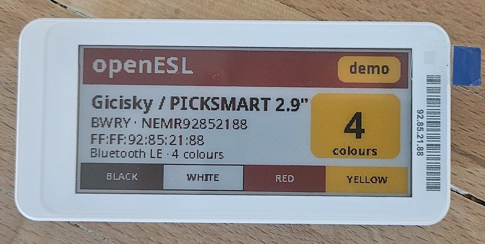

# Bluetooth tags

Bluetooth (BLE) price tags are sold cheaply under several brands. Unlike the SoluM tags
they keep their maker's firmware: openESL does not flash them, it speaks their protocol.
The protocol for one tag family is recorded in [gicisky-296-bwry.md](gicisky-296-bwry.md);
the S3 AP speaks it next to its 802.15.4 tags, and the C6 has a separate Bluetooth AP
build ([Which AP](#which-ap)). This page records what is built and what is still to
do.

## How they differ from the 802.15.4 tags

| | SoluM tags (802.15.4) | Bluetooth tags |
|---|---|---|
| Firmware on the tag | openESL's own | the maker's |
| Who starts a transfer | the tag: it polls the AP, the AP answers (`esl_radio`) | the AP: it connects to the tag and sends the picture (`esl_push`) |
| What the AP sends | a picture it draws (`esl_render`, `esl_image`), in blocks over our protocol | the same picture, packed for the maker's protocol |
| Radio on the AP | 802.15.4 (C6, C5, or a C6 next to an S3) | BLE (any ESP32 with BLE) |

So drawing the screen, the store, the API, the dashboard and Home Assistant stay as they
are. What is new is how the picture gets to the tag.

## Recorded tags

| Tag | Panel | Radio | Protocol |
|---|---|---|---|
| Gicisky / PICKSMART 2.9" BWRY (sold under several names; our units advertise as `NEMR…`) | 296 × 128, black/white/red/yellow | BLE | [gicisky-296-bwry.md](gicisky-296-bwry.md) |

  

## Parts

1. **Learning a tag's protocol:** [`tools/ble-probe`](../tools/ble-probe/README.md) reads a
   phone's Bluetooth log of the maker's app and lists what it wrote to which
   characteristic. A Nordic nRF52840 dongle with the nRF Sniffer for Bluetooth LE
   firmware records the air traffic when a phone is not available. Clean-room: only our
   own recordings of our own tags and the makers' published documents, and what we learn
   is written here in our own words. The first result is
   [gicisky-296-bwry.md](gicisky-296-bwry.md).
2. **Delivery** (`esl_core/esl_push.c`, built and tested on the PC, and used by the BLE
   AP): the tags the AP sends to itself. Each round, a tag whose content gives another
   image than the one it was last given gets it through a transport. A tag that is not
   reached is tried again after 30 s, doubling up to 30 min, or at the next round when
   the scan hears it (once per run of misses, so a tag that is heard but cannot be
   connected to keeps its back-off). A tag that refuses an image is not sent it again until its content changes.
   After each attempt the store is told as if the tag had polled (its model, battery and
   the image it shows), so "last seen", battery and "shows its content" work as for any
   tag.
3. **BLE on the AP:** NimBLE in the central role, a scan that reports tags to
   `esl_push_seen`, and the transport `send`, which connects, hands the picture to the
   tag's protocol module and disconnects. The transport adapter `esl_ble.c` is built and
   tested on the PC; the NimBLE backend and the scan are in `ap/main/ble.c`, built into
   the S3 boards next to their 802.15.4 tags and with `python ap/build.py --ble <board>`
   for the C6, and tried on two units with a C6. The C6's BLE AP is its own app,
   `esl_ap_ble`, so it takes only its own image over the air and an 802.15.4 AP refuses
   it (`ap/main/ota.c`); GET /api/ota says `app`. Releases carry it for the C6 Super
   Mini as `openesl-ap-esp32c6-ble-<version>.bin` and `-ota.bin`, the web page's Flash AP
   tab offers it as its own card (`ble_aps` in `firmware/info.json`), and the dashboard of
   a BLE AP offers its update. A BLE AP built from 1.0.0 (app `esl_ap`) is offered no
   update and takes one USB flash. Tags are added by the scan or
   `CONFIG_ESL_BLE_TAG_MAC`; pairing in the web page is to do. The push table (the image
   id each tag shows) is saved in NVS (`esl_persist.c`'s blob) after each send, so a
   restart does not send an image again.
4. **Protocol modules:** one per tag family, turning a raw picture (the black plane, then
   the red plane, then the yellow plane, or a logical 2-bit image) into the maker's commands. The Gicisky 2.9"
   BWRY protocol is recorded and its module is `esl_gicisky.c`, used by `ap/main/ble.c`.
5. **Models:** `shared/models.json` already has `radio` and `protocol` fields; a
   Bluetooth tag becomes a model with `radio: "ble"` and its maker's protocol. The
   Gicisky 2.9" BWRY is `gicisky-29-bwry`, `2.9-bwry` in the API.
6. **Yellow**: some of these tags are black/white/red/yellow. The AP now draws a third
   plane, so its layouts and designer take `yellow` and `yellow_invert`; the Gicisky
   packer takes the black, red and yellow planes (`esl_gicisky_pack_planes`).

## Which AP

| AP | Bluetooth tags | Why |
|---|---|---|
| ESP32-S3 + C6 (cable or WiFi) | yes, next to the 802.15.4 tags | the S3's own BLE radio is free (the C6 does 802.15.4), and its 3 MB app slots have room (about 195 KB more). `gicisky` is in the board's `protocols` (`board.json`, `ap/manifest.py`) |
| ESP32-C6 (4 MB) | in its own build only (`python ap/build.py --ble c6-supermini`), without 802.15.4 | the image with BLE is about 1.6 MB and the normal table's app slots are 1.5 MB; the Bluetooth AP's table gives up the tag firmware partition for 1.75 MB slots. Both would also share one radio and 512 KB of RAM |
| ESP32-C5 | in its own build only (`--ble`, the `ble` variant), not tried on a board | it has the flash and PSRAM, but WiFi, BLE and 802.15.4 share one radio, so a BLE transfer (several seconds per tag) would take air time from the 802.15.4 tags' 20 ms windows; to be tried on hardware before both go in one build |
| Linux AP | not yet | needs a Bluetooth transport for the Linux host (BlueZ); the SoluM gateway has no Bluetooth |

On an AP with both, the 802.15.4 tags and the Bluetooth tags are in the same table, the
same dashboard and the same API; the radio task and the BLE push task draw into the same
image buffers under a lock.
