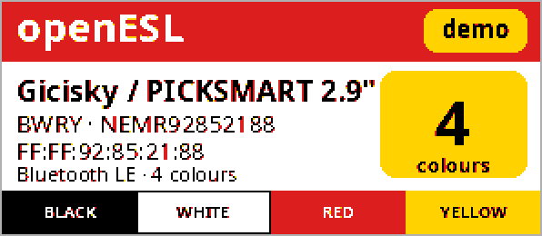
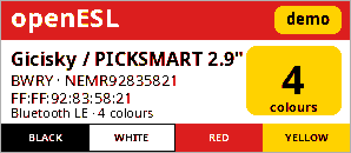

# Gicisky / PICKSMART 2.9-inch BWRY tag

Status: the protocol is recorded from our own captures; the module, the transport adapter
and the AP's NimBLE central are in place, and the push table (the image each tag was last
given) is kept in NVS. The model is supported: it has been tried with the BLE AP on two units
(the demo cards below).

## The tag

- 2.9-inch, 296 × 128, black/white/red/yellow e-paper.
- Bluetooth LE; the tag keeps the maker's firmware and openESL speaks its protocol
  instead of flashing it.
- The same hardware is sold under several names. The unit we recorded advertises as
  `NEMR…` (the serial number), has the GATT name `PICKSMART`, and reports model `0x2E`
  in its manufacturer data.
- Its BLE address was public on our unit. Use the address from the advertisement; do not
  assume the address type.

## How this was recorded

- We followed the tag with a Nordic nRF52840 dongle running nRF Sniffer for Bluetooth LE
  4.1.1, and decoded the ATT traffic in Wireshark/tshark.
- We read the GATT table with [`tools/ble-probe/scan.py`](../tools/ble-probe/scan.py).
- We mapped the image format with our own display tests: three pictures (white, black,
  a black box) and a raw 2-bit framebuffer with one value per quadrant.
- Clean-room: the protocol below is from our own air captures and our own tests. A
  third-party BLE client was used only as a black box to make the tag transmit; its
  source and notes were not read.

## On the air

- Vendor service: `0000fef0-0000-1000-8000-00805f9b34fb`.
- Manufacturer data, company `0x5053`: `2e 20 81 01 40`.
  - We read the first byte, `0x2E` (46), as the model; `0x20` and `0x81` look like
    firmware and hardware revisions, and the last two bytes are not understood.
- The advertisement also carries the `NEMR…` name and the vendor service.
- GATT device name: `PICKSMART`.

## GATT

The handles are from our unit. Use the UUIDs, not the handles.

| Service | Characteristic | Properties | Use |
|---|---|---|---|
| `0x1800` GAP | `0x2A00` | read | name `PICKSMART` |
| | `0x2A01` | read | appearance |
| | `0x2A04` | read | preferred connection parameters |
| `0xFEF0` | `FEF1` (value handle `0x000e`) | write, write without response, notify | commands and status |
| | `FEF2` (value handle `0x0012`) | write, write without response, notify | image chunks |
| | `FEF3` (value handle `0x0015`) | read, write | reads `DEPG` (display type) |
| `0x1801` GATT | `0x2A05` | indicate | service changed |
| `00010203-0405-0607-0809-0a0b0c0d1912` | `00010203-0405-0607-0809-0a0b0c0d2b12` (value handle `0x0018`) | read, write without response, notify | unknown; possibly configuration or OTA |

We saw no pairing or encryption.

## The transfer

The central connects, enables notifications on `FEF1`, and sends:

```
FEF1: 01
FEF1: 02 00 25 00 00 00 00 00
FEF1: 03
FEF2: uint32_le(0)  + first 240 image bytes
FEF2: uint32_le(1)  + next 240 bytes
...
FEF2: uint32_le(39) + last 112 bytes
disconnect
```

- The image is 9472 bytes, split into 40 chunks of 240 bytes; the last chunk has 112
  bytes.
- Each `FEF2` write starts with a 4-byte little-endian chunk index.
- The tag answers on `FEF1`:
  - `01 f4 00` after `01`,
  - `02 00 25` after `02`,
  - `05 00 00 00 00 00` after `03` (ready for chunk 0),
  - `05 00 <n> 00 00 00` after chunk `n - 1` (ready for chunk `n`, `n` = 1–39),
  - `05 08 00 00 00 00` after chunk 39 (done).
- The central waits for the notification before sending the next chunk. We saw a
  repeated `05 00 27 00 00 00` in one capture; the tag tolerated it. We also saw chunk 0
  written twice in two captures (probably a retry after a missed acknowledgement); the
  tag accepted that too.
- The display refreshes when the connection closes. We did not see a separate refresh
  command. The panel flashes black and white during the refresh; that is normal e-paper
  behaviour, not an error.

## The image format

- Logical image: 296 × 128.
- Rotate the logical image 90° counter-clockwise to a 128 × 296 framebuffer.
- Pack 2 bits per pixel, four pixels per byte, most significant bits first.
- Value to colour:

| Value | Colour |
|---|---|
| 0 | black |
| 1 | white |
| 2 | yellow |
| 3 | red |

- In coordinates: `framebuffer[295 - x][y] = logical[x][y]`, where `x` is 0–295 and `y`
  is 0–127. Equivalently, the framebuffer is the logical image rotated 90°
  counter-clockwise.
- Check: a 60 × 60 black square at the logical top-left landed at framebuffer columns
  0–59 and rows 236–295. A raw framebuffer with values 0, 1, 2 and 3 in the four logical
  quadrants showed black, white, yellow and red in those quadrants.

## The demo cards

<table>
  <tr>
    <td align="center"><br><sub>NEMR92852188 (FF:FF:92:85:21:88)</sub></td>
    <td align="center"><br><sub>NEMR92835821 (FF:FF:92:83:58:21)</sub></td>
  </tr>
</table>

The two tags on our desk show these cards, each with its own BLE name and address: a red
band with the openESL name, a yellow demo badge and a yellow block, black text, and the
four colours along the bottom. They are the images the tags were sent, drawn by
[`tools/gallery/render_bwry.py`](../tools/gallery/render_bwry.py) and also used in the
README gallery.

The AP draws all four colours: the layout compiler takes `red`, `red_invert`, `yellow`
and `yellow_invert`, the renderer has a black, red and yellow plane, and the push task
packs them with `esl_gicisky_pack_planes` (the tag's logical 2-bit image). The cards
above were sent as that 2-bit image through the same FEF1/FEF2 sequence; a layout with
the same colours goes through the AP by itself ([ble-tags.md](ble-tags.md)).

## The AP build

The BLE AP is a separate firmware choice: `python ap/build.py --ble c6-supermini` (after
`source ~/esp/esp-idf-v5.5.5/export.sh`). It reads `ap/ble.sdkconfig.defaults` and
`ap/ble.partitions.csv` (no 802.15.4 tag firmware partition, two 1.75 MB app slots) and
writes `ap/out/openesl-ap-ble.bin`. It runs WiFi and the BLE central; 802.15.4 is off.

The AP adds a Gicisky tag the scan hears (`CONFIG_ESL_BLE_AUTO_ADD`) or the MAC in
`CONFIG_ESL_BLE_TAG_MAC`. The tag appears in the API and the dashboard as model
`2.9-bwry` (code 4). Set its content as for any tag, for example
`PUT /api/tags/<mac>` with the built-in `price` layout; the push task draws it, packs the
black, red and yellow planes with `esl_gicisky_pack_planes` and sends it. `ap/main/ble.c` asks for an ATT MTU of at
least 247, discovers `FEF1`/`FEF2` by UUID, enables notifications on `FEF1`, writes the
244-byte chunks and waits for each `05 00 <n>`.

An example layout file for the model is [`tag/designs/layouts/2.9-bwry.json`](../tag/designs/layouts/2.9-bwry.json)
(the 2.9" layouts with red bands); upload it with `PUT /api/layouts/2.9-bwry`.

## What is not known

- What `02 00 25 …` means. `0x25` is 37, and 296 / 8 = 37, so it may be the row length;
  the five zero bytes and the meaning are not known. The bytes were the same for all the
  pictures we sent.
- What `f4`, `25` and the final `08` in the notifications mean.
- Why our units report model `0x2E`; we do not know how the maker numbers the BWRY
  variant.
- Whether the tag accepts other chunk sizes, partial updates or several images.
- What the `…1912` service and the writable `FEF3` do.
- Whether a tag ever requires pairing or encryption; ours did not.
- The exact retry and timeout rules; we saw one retry of chunk 0 and one repeated
  acknowledgement.
- The meaning of the battery and voltage bytes in the manufacturer data.
- The MTU exchange, the notifications and the refresh timing worked on our two units;
  other units are not tried.
- Pairing in the web page is to do; the scan can add a tag, `CONFIG_ESL_BLE_TAG_MAC`
  names one, and the push table (the image id each tag shows) is kept in NVS.

## Next

- Pairing in the web page, so a tag can be added and chosen there.
- Try more units and other AP boards (C5, S3) with the BLE build.
