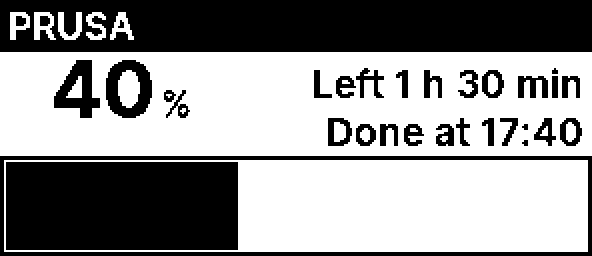

# Home Assistant: 3D printer status on a tag

Home Assistant can be a client of the AP's API like any other: it sends the text straight to the AP with `PUT /api/tags/{mac}` ([openapi.yaml](openapi.yaml)) and the built-in layout `text`, four lines of free text. This example shows the status of a 3D printer whose data Home Assistant already has as entities. The same pattern works for any other sensor.

Replace these before you paste:
- `openesl.local`: the name of your AP on the network, `openesl-xxxx.local` on an AP set up after 0.6.0 (or its IP)
- `00000123456789A8`: the full MAC of the tag (16 hex digits), from `GET /api/tags` or the dashboard
- `sensor.printer_*`: your own entities for status, progress (%), time remaining (minutes) and file name

## 1. `secrets.yaml`

```yaml
esl_auth: "Bearer YOUR_API_TOKEN"
```

## 2. `configuration.yaml`

```yaml
rest_command:
  esl_tag_text:
    url: "http://openesl.local/api/tags/{{ mac }}"
    method: PUT
    headers:
      Authorization: !secret esl_auth
    content_type: "application/json"
    payload: >-
      {"layout":"{{ layout | default('text') }}","fields":{{ fields | to_json }}}
```

Restart Home Assistant (or reload the YAML) after this.

## 3. Automation

```yaml
alias: 3D printer to ESL tag
mode: queued
max: 2
triggers:
  # At once when the status changes (start, pause, finished, error)
  - trigger: state
    entity_id: sensor.printer_status
  # Every 5 minutes while printing
  - trigger: time_pattern
    minutes: "/5"
conditions:
  - condition: or
    conditions:
      - condition: template
        value_template: "{{ trigger.platform == 'state' }}"
      - condition: state
        entity_id: sensor.printer_status
        state: "printing"
actions:
  - variables:
      status: "{{ states('sensor.printer_status') }}"
      pct: "{{ ((states('sensor.printer_progress') | float(0) / 5) | round(0) * 5) | int }}"
      left: "{{ ((states('sensor.printer_remaining_time') | int(0) + 4) // 5) * 5 }}"
      name: "{{ states('sensor.printer_task_name')[:20] }}"
  - action: rest_command.esl_tag_text
    data:
      mac: "00000123456789A8"
      fields: >-
        
        {{ ['Printing: ' ~ pct ~ ' %', name,
            'Left: ' ~ (left // 60) ~ ' h ' ~ (left % 60) ~ ' min',
            'Done at ' ~ (now() + timedelta(minutes=left)).strftime('%H:%M')] }}
        
        {{ ['Printer: ' ~ status, name, 'Updated ' ~ now().strftime('%H:%M')] }}
        
```

Change `printing` to the state your integration uses (for example `running` for Bambu Lab). While printing the tag shows, for example, `Printing: 40 %`, `Benchy.3mf`, `Left: 1 h 25 min` and `Done at 15:54`.

## With a progress bar



The layout `3d-printer` comes for the 2.9" in [tag/designs/layouts/3d-printer-2.9.json](../tag/designs/layouts/3d-printer-2.9.json) and the 1.54" in [tag/designs/layouts/3d-printer-1.54.json](../tag/designs/layouts/3d-printer-1.54.json), with the same six fields in this order:

| Field | Shows | Example |
|---|---|---|
| `printer` | the printer's name, in the black band | `Core One` |
| `name` | file name or material, right in the band; may be empty | `Benchy.gcode` |
| `pct` | progress, digits only (the `%` is fixed text) | `70` |
| `left` | time left | `Left 0 h 40 min` |
| `done` | finish time | `Done at 09:40` |
| `bar` | the progress bar: spaces, 31 fill it on the 2.9", 20 on the 1.54" | `' ' * 22` |

Layout files have no bar element, so the bar is an inverted text field of spaces: the black box hugs the text. Nothing in the layout is tied to one printer, so one layout serves every printer and each printer has its own automation and tag.

Copy the layout into the AP's file for the tag's model (`GET /api/layouts/2.9`, add it to `layouts`, `PUT` it back, or `esl-client layouts` and `layout-put 2.9 FILE`). It takes 176 bytes compiled; the AP's limits are in `GET /api/layouts`, so drop example layouts no tag uses if it does not fit.

Both automations below run every 10 minutes while printing and round down to 10 % and 10 minutes, so the tag redraws at most 6 times an hour. Progress is rounded down, not to the nearest, so the tag never shows 100 % before the print is done. For a 1.54" tag, change `31` to `20` in the bar.

### PrusaLink

With the PrusaLink integration (here a printer named `Core One`, entities `sensor.prusa_core_one*`). It leaves the file name out, and shows the status and material when the printer is idle:

```yaml
alias: 3D printer to ESL tag
mode: queued
max: 2
triggers:
  # Only when the state itself changes (to: null ignores attribute changes)
  - trigger: state
    entity_id:
      - sensor.prusa_core_one
      - sensor.prusa_core_one_material
    to: null
  # Every 10 minutes while printing: at most 6 redraws an hour
  - trigger: time_pattern
    minutes: /10
conditions:
  - condition: or
    conditions:
      - condition: template
        value_template: "{{ trigger.platform == 'state' }}"
      - condition: state
        entity_id: sensor.prusa_core_one
        state: printing
actions:
  - variables:
      printer: Core One
      status: "{{ states('sensor.prusa_core_one') }}"
      # Rounded down so the text only changes in steps: 10 %, 10 min
      pct: "{{ ((states('sensor.prusa_core_one_progress') | float(0) / 10) | round(0, 'floor') * 10) | int }}"
      fin: "{{ ((as_timestamp(states('sensor.prusa_core_one_print_finish'), 0) / 600) | round(0) * 600) | int }}"
      left: >-
        {{ (((([fin - as_timestamp(now()), 0] | max) / 600) | round(0, 'ceil')) | int * 10) if fin else 0 }}
  - action: rest_command.esl_tag_text
    data:
      mac: "00000123456789A8"
      layout: 3d-printer
      # printer, name, pct, left, done, bar (31 spaces = full bar on 2.9", 20 on 1.54")
      fields: >-
        
        {{ [printer, '', pct | string,
            'Left ' ~ (left // 60) ~ ' h ' ~ (left % 60) ~ ' min',
            'Done at ' ~ (fin | timestamp_custom('%H:%M') if fin else '?'),
            ' ' * ((pct | int * 31 / 100) | round(0) | int)] }}
        
        {{ [printer, '', '-', status | capitalize, 'Material: ' ~ states('sensor.prusa_core_one_material')] }}
        
```

### Moonraker (Klipper)

With the [Moonraker integration](https://github.com/marcolivierarsenault/moonraker-home-assistant) from HACS (here a Snapmaker, entities `sensor.snapmaker_*`; replace `snapmaker` with your printer's name). Its `printer_state` stays `ready` while printing, so the print status comes from `current_print_state` (`printing`, `paused`, `complete`, `standby`, `error`). `print_eta` is a timestamp:

```yaml
alias: Snapmaker to ESL tag
mode: queued
max: 2
triggers:
  - trigger: state
    entity_id: sensor.snapmaker_current_print_state
    to: null
  # Every 10 minutes while printing: at most 6 redraws an hour
  - trigger: time_pattern
    minutes: /10
conditions:
  - condition: or
    conditions:
      - condition: template
        value_template: "{{ trigger.platform == 'state' }}"
      - condition: state
        entity_id: sensor.snapmaker_current_print_state
        state: printing
actions:
  - variables:
      printer: Snapmaker
      status: "{{ states('sensor.snapmaker_current_print_state') }}"
      # Rounded down so the text only changes in steps: 10 %, 10 min
      pct: "{{ ((states('sensor.snapmaker_progress') | float(0) / 10) | round(0, 'floor') * 10) | int }}"
      fin: "{{ ((as_timestamp(states('sensor.snapmaker_print_eta'), 0) / 600) | round(0) * 600) | int }}"
      left: >-
        {{ (((([fin - as_timestamp(now()), 0] | max) / 600) | round(0, 'ceil')) | int * 10) if fin else 0 }}
  - action: rest_command.esl_tag_text
    data:
      mac: "00000123456789A8"
      layout: 3d-printer
      # printer, name, pct, left, done, bar (31 spaces = full bar on 2.9", 20 on 1.54")
      fields: >-
        
        {{ [printer, '', pct | string,
            'Left ' ~ (left // 60) ~ ' h ' ~ (left % 60) ~ ' min',
            'Done at ' ~ (fin | timestamp_custom('%H:%M') if fin else '?'),
            ' ' * ((pct | int * 31 / 100) | round(0) | int)] }}
        
        {{ [printer, '', '-', status | capitalize, ''] }}
        
```

To show the file name in the band, put `states('sensor.snapmaker_filename')` in place of the `''` after `printer`.

## A picture instead of text

For what four lines cannot show (a chart, a camera snapshot, a dashboard drawn elsewhere), the AP takes a PNG with `PUT /api/tags/{mac}/image` ([openapi.yaml](openapi.yaml)) and sends it to the tag as it is. The PNG must be exactly the tag's screen size: 296 x 128 for the 2.9", 200 x 200 for the 1.54". The AP turns each pixel into black or white (the nearest), or with `?dither=true` mixes them for shades of grey, which suits photos. The tag must have polled the AP once.

`rest_command` sends text only, so the file goes with `curl` from a `shell_command`. Put the whole command in `secrets.yaml`, since the token is in it:

```yaml
# secrets.yaml
esl_picture: >-
  curl -s -f -X PUT -H "Authorization: Bearer YOUR_API_TOKEN" --data-binary @{{ file }}
  http://openesl.local/api/tags/{{ mac }}/image{{ '?dither=true' if dither | default(false) else '' }}
```

```yaml
# configuration.yaml
shell_command:
  esl_picture: !secret esl_picture
```

Then in an automation or script, with a PNG that something else has written (a camera snapshot resized to the screen, an image from another integration):

```yaml
action: shell_command.esl_picture
data:
  mac: "00000123456789A8"
  file: /config/www/tag.png
  dither: true
```

A picture costs about 5 KB of the AP's NVS per tag (less for one with large areas of one colour), and a new one a full download and redraw on the tag, so it is for a few tags and changes now and then, not for prices. Sending text again (`rest_command.esl_tag_text`) replaces the picture.

## Limits and timing

- **Text:** 4 fields (lines), 92 characters in all after conversion to Latin-1 (96 bytes with the length bytes, [protokoll.md](protokoll.md) part 1). æøå work. Over the limit the AP answers `422` and the tag keeps what it shows.
- **Line width:** about 20 characters per line on the 2.9" before the text drops to a smaller font or is cut with "…". The 1.54" wraps to two lines per field.
- **When it shows:** the tag polls the AP every 60 s, so a change shows within about a minute plus drawing.
- **Battery:** the AP compares the content. The same text again gives `changed: false` and the tag does not draw again, which is why the numbers are rounded (5 % and 5 min): a new screen costs power (the image download and the refresh), the same text again does not. A 6-hour print gives about 70 updates, while the power budget ([strombudsjett.md](strombudsjett.md)) assumes about one a day, so for daily use 10 % or 10 min is kinder. Do not lower the tag's `poll_s` for this.
- **"Done at":** changes when the estimate moves, which is an extra redraw. Remove the line if that is too often.

## Test without the automation

Developer tools → Actions → `rest_command.esl_tag_text`:

```yaml
mac: "00000123456789A8"
fields: ["Printing: 42 %", "Benchy.3mf", "Left: 1 h 25 min", "Done at 17:40"]
```
