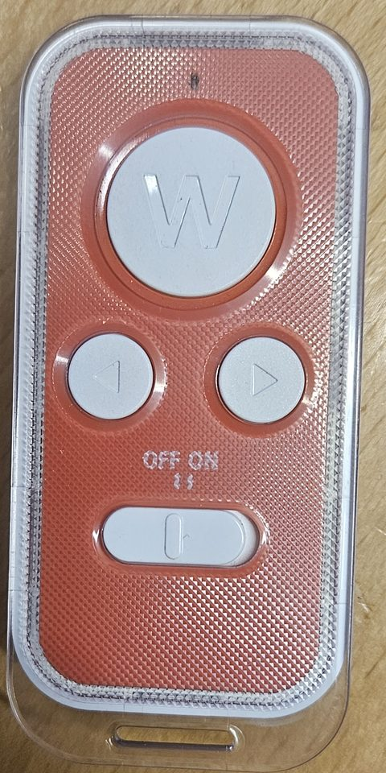
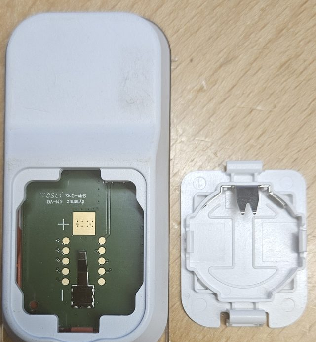

# SoluM ESL remote (SLT-RC004)

A handheld remote that SoluM sold to shops for its stock ESL system. openESL uses it as a wireless button with three buttons: the AP hears its presses and posts each one to a webhook, which the [Home Assistant integration](https://github.com/mathiasbk/openesl-homeassistant) turns into an event. The user's side is in the wiki ([SoluM remote](../wiki/sending-content/SoluM-remote.md)); this page is how it works.

 

## The device

| | |
|---|---|
| Model | SLT-RC004, FCC ID [E2X-RC](https://fccid.io/E2X-RC) ("ESL Remote Controller", Samsung Electro-Mechanics, granted 2014-10-13) |
| Radio | 2405–2480 MHz, 8 mW, IEEE 802.15.4 (the FCC test report is titled "DTS-ZIGBEE") |
| Buttons | **W** (large), **left**, **right**, and an OFF/ON switch |
| Power | 3 V coin cell, held in the battery cover |
| Inside the battery compartment | Ten round pads in two rows of five, likely test or programming pads. Not measured, and the MCU is unknown. |

The newer SoluM Newton "Hybrid Remocon" (EL090MBCX0) is documented: the centre button wakes or refreshes a stock tag, and left and right flip between pages stored on the tag. It adds active NFC. The SLT-RC004 most likely does the same over 2.4 GHz only (inferred, not tested against stock tags).

## What it sends

Measured with a sniffer locked on channel 11 while the buttons were pressed W, left, right, W, left, right, about 1 s apart.

- **Channel 11**, unencrypted 802.15.4 data frames.
- **One press = one burst of 10 identical frames**: 5 frames about 10 ms apart, an ~80 ms gap, then 5 more (~160 ms in all).
- The frame (12-byte PSDU without the FCS):

```
41 88 | seq | FF FF   | FF FF | EF BE        | 19 | cmd | 00
FCF     seq   dst PAN   dst     src = 0xBEEF   payload
```

  - FCF 0x8841: data frame, PAN ID compression, short addresses, no ACK request.
  - Broadcast to PAN 0xFFFF and address 0xFFFF from short address 0xBEEF. The source is the same every time, so the frame carries no identity for the remote.
  - `seq` goes up by 1 per press. All 10 frames of a burst share it, so a receiver can collapse a burst to one press.
  - **`cmd`: 01 = W, 02 = left, 03 = right.**
- No encryption, no rolling code: any 802.15.4 radio can receive the commands, and send them too.
- Signal at the AP, remote held next to it: about −60 to −87 dBm.

Example frames as the sniffer logged them then (the last two bytes are the RSSI and LQI that the ESP-IDF driver writes over the FCS, not frame data; the sniffer now writes `@SNF` lines, which `tools/sniffer/sniff.py` decodes, [radio-sniffer.md](radio-sniffer.md)):

```
rx ch 11 14 B rssi -68: 41 88 9C FF FF FF FF EF BE 19 01 00 BC 0A   W
rx ch 11 14 B rssi -71: 41 88 9D FF FF FF FF EF BE 19 02 00 B8 0A   left
rx ch 11 14 B rssi -76: 41 88 9E FF FF FF FF EF BE 19 03 00 B4 0A   right
```

A second, unrelated and weak sender was also heard on channels 11, 12, 19 and 21: 13-byte broadcasts on PAN 0x1234 from short address 0x10AF, payload `E0 85 xx yy`. It is neither the remote nor openESL.

## How openESL uses it

The AP's radio task hands every frame it receives to `esl_remote_frame()` (`ap/components/esl_core/esl_remote.c`), which checks the frame byte for byte (the FCF, the broadcast addresses, source 0xBEEF, `19 cmd 00`) and turns a burst into one press: a frame with the `seq` of the last press within 1 s is the same press. The last 8 presses are in `GET /api/remote`, and `ap/main/remote.c` POSTs each press to the remote's webhook (`PUT /api/remote {"webhook": ...}`, kept in NVS as `cfg/remote_hook`):

```
{"event":"remote","button":"w","id":3,"boot":2817364121,"rssi":-61}
```

`id` counts presses from 1 after each AP start, and `boot` is a new random number at each start, so a receiver can tell a resent press from a new one. A press that cannot be posted is logged and dropped, not queued: a button pressed minutes ago should not do something now.

### The channel

The remote sends on channel 11 only; openESL runs on channel 25 by default. Two ways for the AP to hear it:

- **Run openESL on channel 11** ([settable channel](../wiki/access-point/Access-point-settings.md), the tags follow the move). Costs nothing. Channel 11 overlaps the lower edge of WiFi channel 1, so it suits a site whose WiFi is on 6 or 11.
- **Listen** (`PUT /api/remote {"listen": true}`, `cfg/remote_listen`): the radio stays on the AP's channel and visits channel 11 for 14 ms every 48 ms (`ESL_REMOTE_VISIT_MS`, `ESL_REMOTE_PERIOD_MS`). A visit is longer than the gap between two frames of a burst, and the visits come often enough that one always covers a frame, for frames 8–12 ms apart and a pause of 60–100 ms (`python3 tools/remote_visits.py` checks the numbers). The radio is away 29 % of the time. A tag whose POLL falls in a visit gets no answer and sends its retry 22–30 ms later, which falls before the next visit, so no POLL is lost, but those POLLs cost the tag about 20 ms more of radio, and they show up as retries in the signal statistics. Only the radio task changes the channel (a timer puts a mark on its queue), so a reply on its way is never cut off, and a frame heard on channel 11 during a visit goes to the remote only: a lost tag that scans channel 11 is not answered from there.

Listen needs the C6 or C5 as the AP's own radio (boards `c6`, `c6-lcd`, `c5`). On an S3 with a C6 on the cable or over WiFi, `/api/remote` answers 404 for now: the C6 would have to do the visits itself, which is a change to its firmware.

### Limits

- All remotes look alike (source 0xBEEF, no serial number in the frame), so the AP cannot tell two remotes apart, and anyone with an 802.15.4 radio can send the same presses. Do not use it to unlock a door.
- A press reaches the webhook within about 0.2 s. It cannot change what a tag shows before the tag's next poll, since the tags sleep in between.
- Whether the remote's channel can be changed (by pairing, say) is unknown. Our own firmware on it, through the ten pads, would give it an address and any channel; the MCU is not known yet.

## How it was measured

- Sniffer build of the AP (`ESL_RADIO_SNIFFER`, [radio-sniffer.md](radio-sniffer.md)), first with `ESL_SNIFFER_HOP_MS=300` (hops through channels 11–26 and stays 10 s on a channel where it heard a frame) to find the channel, then with `ESL_CHANNEL=11` and no hopping to map the buttons. See [ap/README.md](../ap/README.md#configuration).
- The sniffer image was put on the AP with `esl-client ota`, so the AP's settings in NVS stayed. The sniffer never confirms itself (it has no WiFi or API), so the next reset rolls the AP back to its normal firmware. That includes a serial terminal that opens the USB port with DTR/RTS asserted (pyserial's default, `esl-client ota --wait`): open the port with DTR and RTS held low while the sniffer runs.
