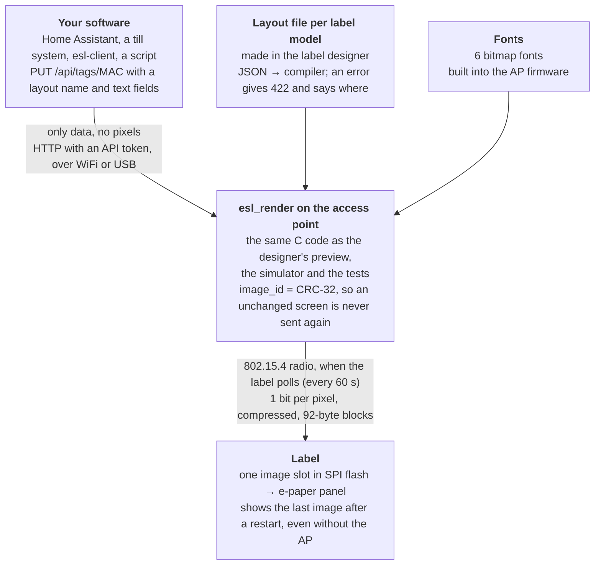

# OpenESL

Open firmware for SoluM e-paper shelf labels and an ESP32 access point. Put prices and text on the labels from any software, with one HTTP request.

  
  &nbsp;
  

This wiki is the user guide: how to get from a box of labels to labels that show your prices. The technical details (protocol, firmware internals, hardware notes) live next to the code in the repository, and the pages here link to them.

## How it works

More: [How it works](How-it-works).

## New here?

1. [What you need](What-you-need): the labels, the access point and the flashing jig.
2. [Getting started](Getting-started): from nothing to the first label, on one page.
3. [Sending content](Sending-content): put text and prices on the labels from your own software.

## The guide

**Getting started**
[How it works](How-it-works) · [Getting started](Getting-started) · [What you need](What-you-need) · [Roadmap](Roadmap)

**Access point**
[Choosing a board](Access-point-boards) · [ESP32-C6](ESP32-C6) · [ESP32-C6 with screen](ESP32-C6-with-screen) · [ESP32-C5](ESP32-C5) · [ESP32-S3 + C6](ESP32-S3-and-C6) · [ESP32-S3 + wireless C6](ESP32-S3-with-wireless-C6) · [Flashing the AP](Flashing-the-access-point) · [WiFi and API token](WiFi-and-API-token) · [AP settings](Access-point-settings)

**Labels**
[Supported labels](Supported-labels) ([2.9"](SoluM-2.9-ST-GM29XX2), [1.54"](SoluM-1.54-ST-GM16XX2)) · [The flashing jig](Flashing-jig) · [Flashing labels](Flashing-labels) · [Label backups](Label-backups) · [Label designer](Label-designer) · [Layout elements and limits](Layout-elements-and-limits) · [Label templates](Label-templates)

**Sending content**
[Overview](Sending-content) · [HTTP API](HTTP-API) · [esl-client](esl-client) · [Price lists from CSV](Price-lists-from-CSV) · [Scheduled prices](Scheduled-prices) · [Home Assistant](Home-Assistant) · [Weather](Weather)

**Running it**
[Dashboard](Dashboard) · [Health and webhook](Health-and-webhook) · [Updating the AP](Updating-the-access-point) · [Updating labels](Updating-labels) · [Upgrading from older versions](Upgrading-from-older-versions) · [Backup and restore](Backup-and-restore) · [Security on the radio](Security-on-the-radio) · [Moving to a new AP](Moving-to-a-new-AP)

**Help**
[Troubleshooting](Troubleshooting) · [FAQ](FAQ)

**Developers**
[Contributing](Contributing) · [Building from source](Building-from-source) · [Adding hardware](Adding-hardware)

## Links

- **Web page:** [https://mathiasbk.github.io/openESL](https://mathiasbk.github.io/openESL/) (flashing, designer, dashboard, API docs)
- **Releases:** [github.com/mathiasbk/openESL/releases](https://github.com/mathiasbk/openESL/releases)
- **Issues:** [report a bug or suggest hardware](https://github.com/mathiasbk/openESL/issues)
- **Licence:** [MIT](https://github.com/mathiasbk/openESL/blob/master/LICENSE)
