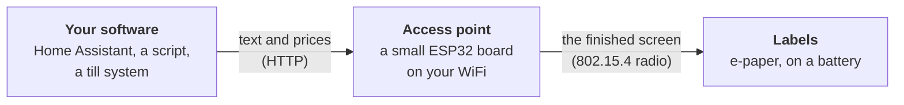

# OpenESL

Open firmware for SoluM e-paper shelf labels and an ESP32 access point. Put prices and text on the labels from any software, with one HTTP request.

  
  &nbsp;
  

This wiki is the user guide: how to get from a box of labels to labels that show your prices. The technical details (protocol, firmware internals, hardware notes) live next to the code in the repository, and the pages here link to them. New words are explained in the [Glossary](Glossary).

## What can I use it for?

- **Prices in a shop:** product name, price, unit price, EAN or QR code, offers that start and end at a set time.
- **At home:** the weather, the bin collection day, the room temperature, the guest WiFi as a QR code, from [Home Assistant](Home-Assistant) or your own scripts.
- **In the workshop:** a 3D printer's progress, labels on filament spools, boxes and shelves.

The labels are shop shelf labels, often sold cheaply second-hand. They run for years on a coin cell and keep showing their screen without power.

## What you need to get started

<table>
  <tr>
    <td align="center" valign="top" width="25%"> <b>Labels</b> A <a href="SoluM-2.9-ST-GM29XX2">SoluM 2.9"</a> or <a href="SoluM-1.54-ST-GM16XX2">1.54"</a>. Check the product name on the back. Have another label? We would like to support more: <a href="Adding-hardware">tell us</a>.</td>
    <td align="center" valign="top" width="25%"> <b>An access point</b> An ESP32-C6 Super Mini (about 5 $) is enough to start. <a href="Access-point-boards">Other boards</a> Another board in mind? Support for more is welcome: <a href="Adding-hardware#a-new-access-point-board">see how</a>.</td>
    <td align="center" valign="top" width="25%"> <b>A flashing jig</b> A small board running ZBS_Flasher (a Wemos D1 mini, an ESP32, an Arduino Nano and others) and pogo pins, to flash each label once. <a href="Flashing-jig">How to build it</a></td>
    <td align="center" valign="top" width="25%"><b>A computer</b> With Chrome or Edge, to flash from the <a href="https://mathiasbk.github.io/openESL/">web page</a>. Nothing to install.</td>
  </tr>
</table>

Plus a USB cable for the AP and one for the flasher board, and CR2450 cells for the labels. The full list: [What you need](What-you-need).

## How it works, in short

Your software sends text, the access point (AP) draws the screen from a layout you choose, and each label fetches its new screen by radio about once a minute. The details: [How it works](How-it-works).

## New here?

1. [What you need](What-you-need): the labels, the access point and the flashing jig.
2. [Getting started](Getting-started): from nothing to the first label, on one page.
3. [Sending content](Sending-content): put text and prices on the labels from your own software.

**No hardware yet?** The [simulator](https://github.com/mathiasbk/openESL/blob/master/sim/README.md) runs the label firmware and the AP together on a PC, and the [label designer](https://mathiasbk.github.io/openESL/#design) works in any browser.

**Want to help?** Photos of a label we do not support yet, a report from a board marked experimental, a new template or a clearer sentence here are all welcome. See [Contributing](Contributing).

## The guide

**Getting started**
[How it works](How-it-works) · [Glossary](Glossary) · [Getting started](Getting-started) · [What you need](What-you-need) · [Roadmap](Roadmap)

**Access point**
[Choosing a board](Access-point-boards) · [ESP32-C6](ESP32-C6) · [ESP32-C6 with screen](ESP32-C6-with-screen) · [ESP32-C5](ESP32-C5) · [ESP32-S3 + C6](ESP32-S3-and-C6) · [ESP32-S3 + wireless C6](ESP32-S3-with-wireless-C6) · [Flashing the AP](Flashing-the-access-point) · [WiFi and API token](WiFi-and-API-token) · [AP settings](Access-point-settings)

**Labels**
[Supported labels](Supported-labels) ([2.9"](SoluM-2.9-ST-GM29XX2), [1.54"](SoluM-1.54-ST-GM16XX2)) · [The flashing jig](Flashing-jig) · [Flashing labels](Flashing-labels) · [Label backups](Label-backups)

**Layouts**
[Label designer](Label-designer) · [Label templates](Label-templates) · [Getting layouts onto the AP](Getting-layouts-onto-the-AP) · [Layout elements and limits](Layout-elements-and-limits)

**Sending content**
[Overview](Sending-content) · [HTTP API](HTTP-API) · [esl-client](esl-client) · [Price lists from CSV](Price-lists-from-CSV) · [Scheduled prices](Scheduled-prices) · [Home Assistant](Home-Assistant) · [Weather](Weather)

**Running it**
[Dashboard](Dashboard) · [Health and webhook](Health-and-webhook) · [Updating the AP](Updating-the-access-point) · [Updating labels](Updating-labels) · [Upgrading from older versions](Upgrading-from-older-versions) · [Backup and restore](Backup-and-restore) · [Moving to a new AP](Moving-to-a-new-AP)

**Help**
[Troubleshooting](Troubleshooting) · [FAQ](FAQ)

**Developers**
[Contributing](Contributing) · [Building from source](Building-from-source) · [Adding hardware](Adding-hardware)

## Links

- **Web page:** [https://mathiasbk.github.io/openESL](https://mathiasbk.github.io/openESL/) (flashing, designer, dashboard, API docs)
- **Releases:** [github.com/mathiasbk/openESL/releases](https://github.com/mathiasbk/openESL/releases)
- **Issues:** [report a bug or suggest hardware](https://github.com/mathiasbk/openESL/issues)
- **Licence:** [MIT](https://github.com/mathiasbk/openESL/blob/master/LICENSE)
