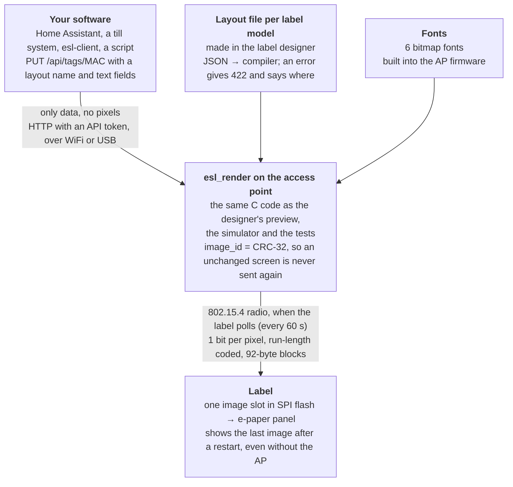

# How it works

1. **Your software sends data, not pixels.** One HTTP request per label (or up to 50 at once) names a layout and gives the text fields. See [Sending content](Sending-content).
2. **The access point draws the screen.** It keeps the text per label, and draws the label's screen from the layout file for that model and the fonts built into its firmware. The drawing code is the same C code as the preview in the [Label designer](Label-designer), the simulator and the tests, so what you see in the browser is what the label shows.
3. **The label asks, the AP answers.** Every 60 seconds the label wakes, asks "anything new?", and goes back to sleep. When its screen has changed, the AP sends the new image over the 802.15.4 radio in small blocks.
4. **The label shows it.** It stores the image in its SPI flash and draws it on the e-paper panel. After a restart it shows the last image again, even without the AP.

An image that has not changed is never sent again, and a label only redraws when its screen really changed. That is what keeps the batteries going.

The design in more depth: [docs/README.md](https://github.com/mathiasbk/openESL/blob/master/docs/README.md#the-main-choices-short-version) and [docs/arkitektur.md](https://github.com/mathiasbk/openESL/blob/master/docs/arkitektur.md).
