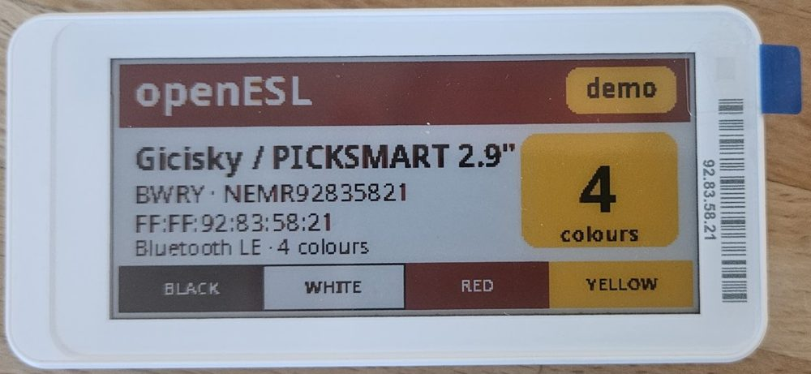

# Roadmap

What OpenESL wants to get better at, roughly in order. Nothing here has a date: it is a spare-time project, and the order changes when hardware turns up or someone sends a pull request. Smaller items are [open issues](https://github.com/mathiasbk/openESL/issues).

## Next

- **More label models, with red first.** SoluM M2 labels, on the same ZBS243 chip as today's two, so the radio, updates and flashing stay the same and only the panel is new:
  - the 2.9" black/white/red (ST-GR29000) ([#255](https://github.com/mathiasbk/openESL/issues/255)): in the firmware as [experimental](SoluM-2.9-red-ST-GR29000), waiting for someone to try it on a real label,
  - the 4.2",
  - the 2.6" and 1.6".

  The image format, the AP's drawing and the designer already have a red plane; what is new for each model is its entry in `shared/models.json`, the panel settings in the label firmware, and testing on a real label. The larger screens also need fewer round trips for their bigger images ([#180](https://github.com/mathiasbk/openESL/issues/180)). Have one of these, or another label? See [Adding hardware](Adding-hardware).
- **Several radios in one place, tried on hardware:** one S3 AP keeps the labels and the API, and up to four wireless C6 radios cover more rooms. The firmware is in 0.10.0 but has not run with several C6 boards yet; still to do are a C6 on its own as the main AP, and picking the radio that hears a label best ([#259](https://github.com/mathiasbk/openESL/issues/259)).

- **Bluetooth labels, the next steps.** The [Gicisky/PICKSMART 2.9" BWRY](Gicisky-2.9-BWRY) works with a separate BLE AP build on an ESP32-C6, in black, white, red and yellow from layouts and the designer ([#476](https://github.com/mathiasbk/openESL/pull/476)), and comes in the next release. Still to do are adding a tag from the web page, its battery reading, and more Bluetooth labels.

  

- **Labels without flashing, tried on more labels:** the AP can already answer SoluM labels on their original firmware (experimental, [Labels without flashing](Labels-without-flashing)); still to do are a run of the AP firmware against a label, a try on the 2.9", the option in the ready-made firmware on the Flash AP tab, and the S3 + C6 and Linux APs.

## Later

- **Security on the radio:** content and label firmware that only your AP can send (see [SECURITY.md](https://github.com/mathiasbk/openESL/blob/master/SECURITY.md) for what is not protected today) ([#260](https://github.com/mathiasbk/openESL/issues/260)). A first version with pairing was in 0.9.0 and taken out again in 0.9.2, because a label could only be brought back in the jig if the AP's key was lost; it is kept for later ([#289](https://github.com/mathiasbk/openESL/issues/289)). The wireless C6 radio also needs a password on its link to the S3.
- **More than one image per label**, so a scheduled price switches at its time without a download, and a button can page between screens ([#179](https://github.com/mathiasbk/openESL/issues/179)).
- **Measured battery life and range:** the figures in the [power budget](https://github.com/mathiasbk/openESL/blob/master/docs/power-budget.md) are still estimates; they will be measured on real labels with a current meter, and the range per antenna and transmit power measured too.

## Some day

- **Labels with other chips**, which also means flashing with an ordinary debug probe instead of the jig:
  - SoluM M3 "Newton" (SiLabs EFR32), also sold in black/white/red/yellow and with a button,
  - Hanshow Nebular (nRF52).
- **Buttons, LED and NFC** on the labels that have them, passed on to webhooks and Home Assistant.

## Done recently

- **0.11.0:** labels stay with their own AP (AP id), labels keep their picture until a new one is fully downloaded, circles, polygons and charts in layouts, night mode, an update window and daily or weekly scheduled content, data sources on an S3 or C5 AP (picture from a URL, electricity price, countdown, news, calendar, exchange rate, bitcoin), new label firmware to one label of each model first, a demo without hardware in one command, and the AP as a Linux program (experimental).
- **0.10.0:** font files made in the browser, rotated text, more fields and UTF-8 with fields by name, up to four wireless C6 radios per S3 (not tried on hardware with several yet), and a warning when an S3 loses its C6 radio.
- **0.9.0** (use 0.9.2): choosing the radio channel on the Settings page, labels that find the AP by themselves when it changes channel, signal history on the Dashboard and less battery use in the label, date and week in layouts, and Home Assistant reading only the labels that changed instead of the whole list.

What each release brought, in detail, is on the [releases page](https://github.com/mathiasbk/openESL/releases).

## Want to help?

Testing on labels and boards we do not have is the most useful thing right now. Open an [issue](https://github.com/mathiasbk/openESL/issues/new/choose) or read [Contributing](Contributing).
