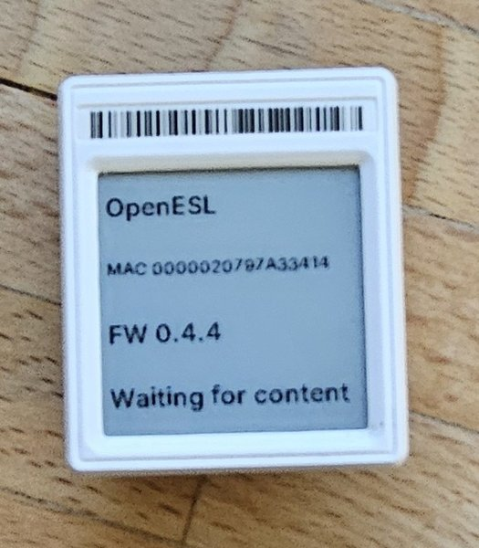
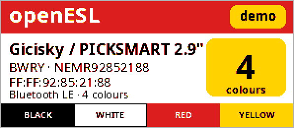
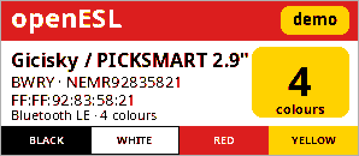
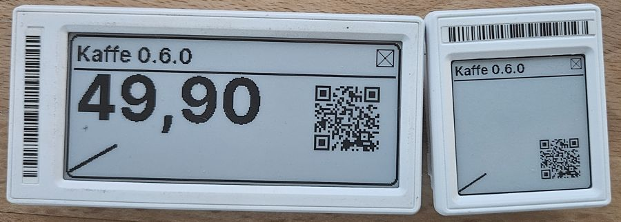

# Supported labels

OpenESL runs on these labels. Each has its own page with photos, specifications, how to recognise it and what is known about it. Click a photo or a name to open it.

| Label | Product | Screen | Colours | Chip | Battery | Battery reading | Status | Photo |
|---|---|---|---|---|---|---|---|---|
| [SoluM 2.9"](SoluM-2.9-ST-GM29XX2) | ST-GM29XX2 | 296 × 128 | black/white | ZBS243 | two CR2450 | yes | supported |  |
| [SoluM 1.54"](SoluM-1.54-ST-GM16XX2) | ST-GM16XX2 | 200 × 200 | black/white | ZBS243 | one CR2450 | no (shows 0) | supported |  |
| [SoluM 2.9" red](SoluM-2.9-red-ST-GR29000) (**experimental**) | ST-GR29000 | 296 × 128 | black/white/red | ZBS243 | not checked | not tried | experimental | |

The SoluM labels talk 802.15.4 to the AP, are flashed once in the [jig](Flashing-jig) and then take new firmware over the air. Every [template](Label-templates) has a version for each. One AP serves every kind at the same time.

The list is made from [shared/models.json](https://github.com/mathiasbk/openESL/blob/master/shared/models.json), the one place a label model is described; the [README](https://github.com/mathiasbk/openESL/blob/master/README.md#supported-tags) shows the same list, including the Bluetooth tag below.

## Bluetooth tags

These keep the maker's firmware: openESL speaks their Bluetooth protocol instead of flashing them, with a separate BLE AP build. They do not talk 802.15.4, and the AP's renderer draws their red and yellow too.

<table>
  <tr>
    <td align="center" valign="top"> <a href="Gicisky-2.9-BWRY">Gicisky / PICKSMART 2.9" BWRY</a> 296 × 128 · black/white/red/yellow · Bluetooth LE</td>
    <td align="center" valign="top"> the second unit, NEMR92835821 FF:FF:92:83:58:21</td>
  </tr>
</table>

The two cards are the images the tags were sent: red, yellow, black and white in one screen, each with its own tag name and address. The page tells how to build the BLE AP and send content.

## Which one?

  

- **The 2.9"** for shelf prices: a product name, a big price and a barcode or QR code side by side. Its battery level shows on the dashboard.
- **The 1.54"** where space is short, or for a single number or status, like a 3D printer's progress or a room's temperature.

## What the status means

- **Supported:** works on hardware and is in every release. Not every release is tested on every label model.
- **Experimental:** builds, but is not in a release yet or has not been tested on every label. Reports are welcome.
- **Planned:** someone has asked for it; nothing is built yet.

## Not supported yet

Labels that look like the ones above but are not the same inside do not work with this firmware. Check the product name on the back before you flash. Known look-alikes:

| Label | Why it does not work yet |
|---|---|
| SoluM 1.54" ST-GR16000 | Older label with a 152 × 152 screen and another display |

## Have a label that is not on the list?

OpenESL is meant to grow to more models and other makers than SoluM, also labels with other chips and radios. One other maker is already supported: the [Gicisky 2.9" BWRY Bluetooth tag](Gicisky-2.9-BWRY) above. [Suggest it in an issue](https://github.com/mathiasbk/openESL/issues/new?template=hardware.yml) with photos of the board and what is written on the chip and display. See [Adding hardware](Adding-hardware).
