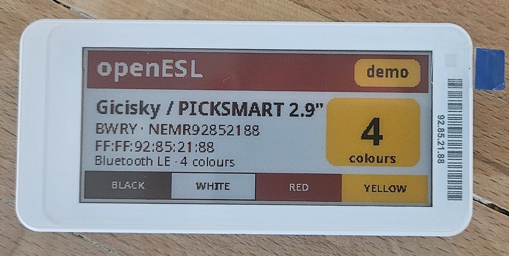
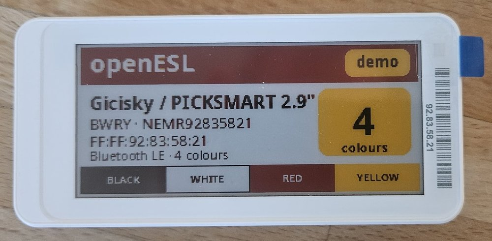
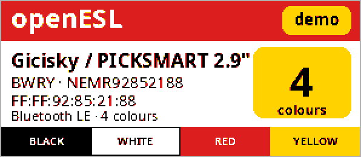
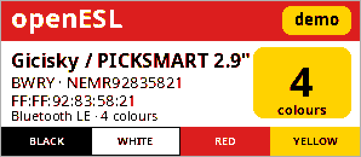

# Gicisky / PICKSMART 2.9" black/white/red/yellow

> **Supported.** The tag keeps the maker's firmware: openESL does not flash it, it speaks the tag's Bluetooth protocol over a separate BLE AP build.

**Status:** supported, tried with the BLE AP on two units. **Model in openESL:** `2.9-bwry` (id `gicisky-29-bwry`), shown as `2.9-bwry` in the API and the dashboard.

The 2.9" with four colours. The same hardware is sold under several names; our units advertise as `NEMR…` (the serial number) and have the GATT name `PICKSMART`.

<p align="center">
  
  &nbsp;
  
</p>

The two units on the desk, each showing the demo card the BLE AP sent it. Below are the same cards as they were drawn.

<table>
  <tr>
    <td align="center" valign="top"><br><sub>NEMR92852188 (FF:FF:92:85:21:88)</sub></td>
    <td align="center" valign="top"><br><sub>NEMR92835821 (FF:FF:92:83:58:21)</sub></td>
  </tr>
</table>

The two cards are the images the tags were sent: red, yellow, black and white in one screen, each card with its own tag name and address.

## Specifications

| | |
|---|---|
| Maker | Gicisky / PICKSMART (sold under several names) |
| Product | PICKSMART 2.9 BWRY |
| Screen | 2.9", 296 × 128 pixels, black/white/red/yellow |
| Radio | Bluetooth LE |
| Firmware | the maker's; openESL speaks its protocol instead of flashing the tag |
| Battery | not checked by openESL |
| Pairing | none seen; the AP connects without a PIN |

## How to use it

1. **Flash the BLE AP**, a separate firmware from the 802.15.4 one. On the [web page](https://mathiasbk.github.io/openESL/), the Flash AP tab has the card **C6 for Bluetooth tags**; each release also has it as `openesl-ap-esp32c6-ble-<version>.bin` (written at 0, like the other AP images) and `-ota.bin` for updates. Or build it yourself:

   ```bash
   source ~/esp/esp-idf-v5.5.5/export.sh
   python ap/build.py --ble c6-supermini
   ```

   The image is `ap/out/openesl-ap-ble.bin`. An ESP32-C6 runs either the Bluetooth tags or the 802.15.4 tags, not both. The BLE build has its own partition table, so moving a board between the two is a USB flash that erases it ([Access point boards](Access-point-boards)). The BLE AP is its own app: it takes only BLE AP updates over the air, and an 802.15.4 AP refuses the BLE image, so the dashboard offers each its own. A BLE AP you built from 1.0.0 needs one USB flash with a newer BLE image; after that its dashboard updates it.

2. **Let the AP hear the tag.** The scan adds a Gicisky tag it hears. To name one, set its address in `CONFIG_ESL_BLE_TAG_MAC`.

3. **Send content as for any tag**, for example with the HTTP API:

   ```bash
   curl -X PUT http://openesl.local/api/tags/0000FFFF92852188 \
     -H "Authorization: Bearer $TOKEN" \
     -d '{"layout": "price", "fields": ["Rye bread", "34,90", "kr 46,53/kg"]}'
   ```

   The AP draws the screen and the BLE central sends it at the tag's next round. The tag appears in the API and the dashboard as model `2.9-bwry`.

## What it can show

- The designer offers the model, with the built-in `price` and `text` layouts, the example layouts (the shelf with a yellow block) and the templates (the shelf with yellow, the others red or black), in `red`, `red_invert`, `yellow` and `yellow_invert` on top of black and white.
- Example layouts: [`tag/designs/layouts/2.9-bwry.json`](https://github.com/mathiasbk/openESL/blob/master/tag/designs/layouts/2.9-bwry.json), the shelf with a yellow block and the others with red bands.
- Yellow is drawn by the AP too: its renderer has a black, red and yellow plane, and the layout compiler and designer take `yellow` and `yellow_invert`.

## What is not known

- Pairing in the web page, and what the battery and voltage bytes in the advertisement mean.
- The full meaning of the command and notification bytes, and whether the tag accepts other chunk sizes.

The protocol, the captures and the AP code are described in [docs/gicisky-296-bwry.md](https://github.com/mathiasbk/openESL/blob/master/docs/gicisky-296-bwry.md). The model entry is in [shared/models.json](https://github.com/mathiasbk/openESL/blob/master/shared/models.json).

Other labels: [Supported labels](Supported-labels).
