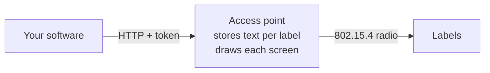

# Sending content

The AP is only an API. It keeps a few text fields and a layout name per label, draws each label's screen from them, and sends it when the label polls. Anything that can make an HTTP request can be a client: a script, a web shop, a till system, home automation.



## The quickest way

```bash
curl -X PUT http://openesl.local/api/tags/00000123456789A8 \
  -H "Authorization: Bearer $TOKEN" \
  -d '{"layout": "price", "fields": ["Lettmelk 1 L", "24,90", "kr 24,90/L"]}'
```

The label shows it at its next poll, about a minute with the default interval. The MAC is on the label's start screen and on the [Dashboard](Dashboard).

## Pick your way in

| You want to | Read |
|---|---|
| Call the API from your own code | [HTTP API](HTTP-API) |
| Use a ready-made command-line client | [esl-client](esl-client) |
| Send a whole price list from Excel or your till | [Price lists from CSV](Price-lists-from-CSV) |
| Change prices at a set time, without your computer on | [Scheduled prices](Scheduled-prices) |
| Show something from Home Assistant | [Home Assistant](Home-Assistant) |
| Send text to many labels by hand | [Dashboard](Dashboard#doing-things-to-many-labels) |

## Good to know

- Sending the same content again costs nothing: the AP sees it is unchanged and the label does not redraw.
- Each new screen costs battery. Content that changes every few minutes (a countdown, a percentage) drains it much faster than daily price changes; round the numbers.
