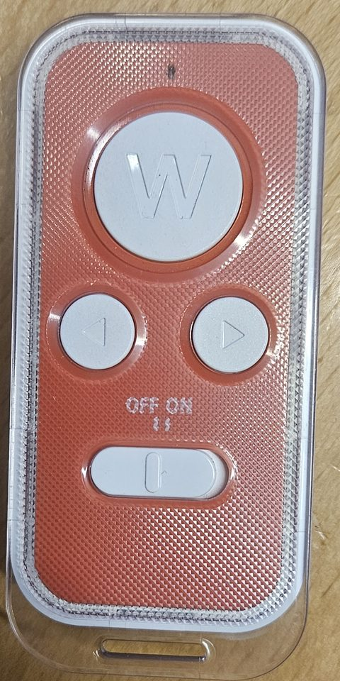
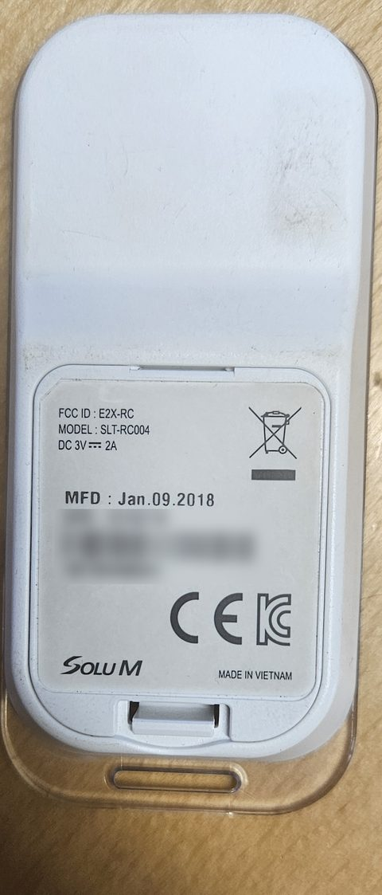

# SoluM remote as a button

The SoluM ESL remote **SLT-RC004** (FCC ID E2X-RC) was made for shop staff to flip pages on stock price labels. With openESL it is a wireless button with three buttons, **W**, **left** and **right**: the AP hears each press and passes it on, to Home Assistant or any other webhook. It needs no new firmware on the remote.

 

Set the switch to **ON**. The remote takes a 3 V coin cell in its battery cover.

## What you need

- An AP with the C6 or C5 as its own radio (boards `c6`, `c6-lcd`, `c5`) and firmware after 0.11.0. An ESP32-S3 with a C6 does not hear the remote yet.
- The AP must be on **channel 11**, the remote's channel, or **listen** for it.

## Channel 11 or listen

The remote sends on 802.15.4 channel 11 only, and the AP and the labels use channel 25 unless you chose another. Pick one:

| | How | Cost |
|---|---|---|
| **Move the AP to channel 11** | Settings → Radio on the [Dashboard](Dashboard), or `esl_client.py config --channel 11` ([AP settings](Access-point-settings)). The labels move with it. | None. Channel 11 overlaps the lower edge of WiFi channel 1, so it suits a site whose WiFi is on channel 6 or 11. |
| **Listen** | Turn on **Listen on channel 11** in Home Assistant, or `PUT /api/remote {"listen": true}`. | The AP's radio is on channel 11 about a third of the time. A label that polls then gets its answer on its retry a few ms later: nothing is lost, but it costs the labels some battery, and the retries show in the signal statistics. |

## In Home Assistant

With the [OpenESL integration](Home-Assistant) (0.6.0 or newer) the remote shows up by itself under the AP as a device **SoluM remote**, with:

- **Button**, an event entity that changes with each press (`event_type` is `w`, `left` or `right`);
- **Listen on channel 11**, the switch above;
- device triggers: in an automation, **Device** → SoluM remote → "W pressed", "Left pressed" or "Right pressed".

The integration gives the AP a webhook of Home Assistant's own, so a press arrives within a fraction of a second, with nothing polling. In YAML, the event `openesl_remote_button` carries the button:

```yaml
triggers:
  - trigger: event
    event_type: openesl_remote_button
    event_data:
      button: w
actions:
  - action: light.toggle
    target:
      entity_id: light.hallway
```

The AP has to reach Home Assistant over plain HTTP on its local address. Home Assistant behind HTTPS only (its own certificate on port 8123) cannot take the AP's posts.

## Without Home Assistant

`PUT /api/remote` sets where each press is posted, and `GET /api/remote` shows the last 8 presses:

```
curl -X PUT -H "Authorization: Bearer $TOKEN" -d '{"webhook":"http://192.168.1.20:8080/button"}' http://openesl.local/api/remote
```

Each press is posted as `{"event":"remote","button":"w","id":3,"boot":2817364121,"rssi":-61}`. A post that fails is not tried again, so a press from minutes ago does not switch something on now. The [HTTP API](HTTP-API) reference has every field.

## Good to know

- **Every SoluM remote looks the same** to the AP: two remotes are one button, and so is a neighbour's. The frames are not encrypted, so anyone with an 802.15.4 radio could fake a press. Use it for lights and scenes, not for a lock.
- The labels sleep between polls, so a press cannot change what a label shows before its next poll.
- How the AP hears it, and the frames it sends: [docs/solum-remote.md](https://github.com/mathiasbk/openESL/blob/master/docs/solum-remote.md).
